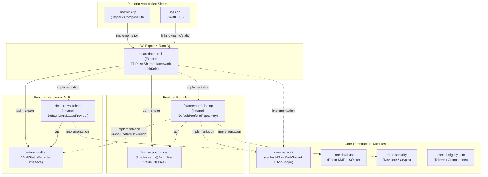
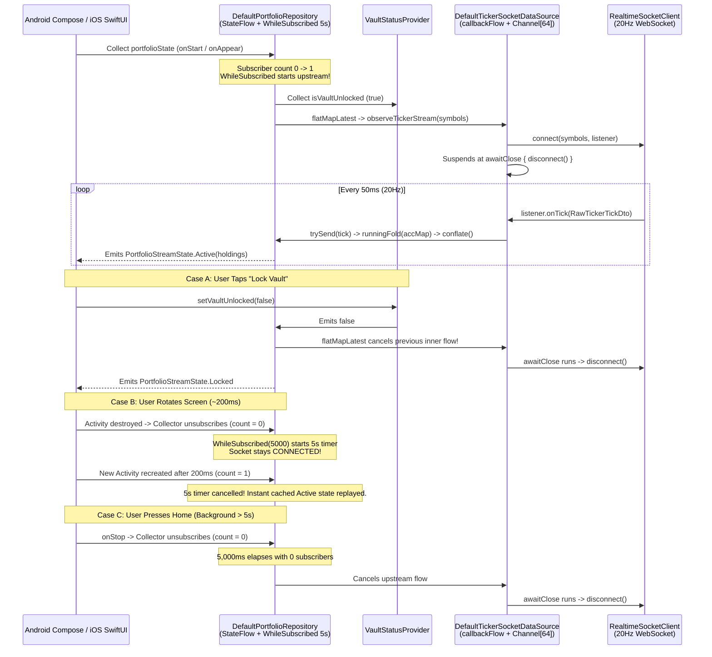

# FinPulse — Staff / Principal Android & KMP Architecture Handbook
**Comprehensive Revision Guide: Phase 1 (Multi-Module KMP & Build Engineering) & Phase 2 (Advanced Kotlin & Coroutines Mastery)**

---

## 📑 Table of Contents
1. [High-Level System Architecture & Module Topology](#1-high-level-system-architecture--module-topology)
2. [Phase 1 Deep Dive: Multi-Module KMP, ABI Boundaries & Build Engineering](#2-phase-1-deep-dive-multi-module-kmp-abi-boundaries--build-engineering)
3. [Phase 1 Interview Questions, Traps & Model Soundbites](#3-phase-1-interview-questions-traps--model-soundbites)
4. [Phase 2 Deep Dive: Real-Time Coroutines, Flow Internals & Value Classes](#4-phase-2-deep-dive-real-time-coroutines-flow-internals--value-classes)
5. [Phase 2 Reactive Pipeline & Memory Diagrams](#5-phase-2-reactive-pipeline--memory-diagrams)
6. [Phase 2 Interview Questions, Curveballs & Model Soundbites](#6-phase-2-interview-questions-curveballs--model-soundbites)
7. [Quick-Reference Cheat Sheet (Before Your Interview)](#7-quick-reference-cheat-sheet-before-your-interview)

---

## 1. High-Level System Architecture & Module Topology

FinPulse is intentionally architected using strict **`:api` and `:impl` module separation**, **Gradle Composite Builds (`build-logic`)**, and a **single iOS Umbrella Framework (`:shared:umbrella`)** to mirror large-scale mobile codebases (50–200+ modules).

### 1.1 Layered Architecture Block Diagram (Universal View)

This layered block diagram illustrates the 5 architectural tiers—from Platform UI Shells down to Core Infrastructure and Build Engineering—so you can sketch it on a whiteboard in 60 seconds during a System Design interview:

```
+===================================================================================================+
|                                LAYER 1: PLATFORM APPLICATION SHELLS                               |
|                                                                                                   |
|  +---------------------------------------------+   +-------------------------------------------+  |
|  |                 :androidApp                 |   |                   iosApp                  |  |
|  |  • FinPulseApplication (initKoin)           |   |  • FinPulseApp.swift (doInitKoin)         |  |
|  |  • MainActivity + Jetpack Compose UI        |   |  • SwiftUI ContentView + ViewModel        |  |
|  |  • Collects StateFlow (Lifecycle-aware)     |   |  • Collects via IosPortfolioBridge        |  |
|  +----------------------+----------------------+   +---------------------+---------------------+  |
+-------------------------|------------------------------------------------|------------------------+
                          | Gradle implementation                          | Links XCFramework
                          v                                                v
+===================================================================================================+
|                           LAYER 2: SHARED UMBRELLA & DI ROOT (:shared:umbrella)                   |
|                                                                                                   |
|  +---------------------------------------------------------------------------------------------+  |
|  | • Single iOS Binary Boundary: FinPulseShared.framework (avoids duplicate K/N runtimes)      |  |
|  | • Root DI Graph: initKoin() aggregates NetworkModule, VaultModule, PortfolioModule          |  |
|  | • iOS Coroutine Bridge (iosMain): IosPortfolioBridge + CloseableSubscription                |  |
|  | • Explicitly exports ONLY :feature:portfolio:api & :feature:vault:api to Objective-C/Swift  |  |
|  +----------------------+------------------------------------------------+---------------------+  |
+-------------------------|------------------------------------------------|------------------------+
                          |                                                |
                          v                                                v
+===================================================================================================+
|                         LAYER 3: FEATURE CONTRACT LAYER (:api Modules — Public ABI)               |
|                                                                                                   |
|  +---------------------------------------------+   +-------------------------------------------+  |
|  |            :feature:portfolio:api           |   |             :feature:vault:api            |  |
|  |  • PortfolioRepository (interface)          |   |  • VaultStatusProvider (interface)        |  |
|  |  • PortfolioStreamState (Locked/Active)     |   |    - val isVaultUnlocked: StateFlow<Bool> |  |
|  |  • @JvmInline value class TickerSymbol      |   |    - fun setVaultUnlocked(Boolean)        |  |
|  |  • @JvmInline value class PriceMicros       |   +-------------------------------------------+  |
|  |  • @JvmInline value class QuantityMicros    |                         ^                        |
|  +----------------------+----------------------+                         |                        |
+-------------------------|------------------------------------------------|------------------------+
                          | implements (api)      Cross-Feature Inversion  | depends on (impl)
                          |                       (@Provided via Koin KSP) |
+-------------------------|------------------------------------------------|------------------------+
|                         |   LAYER 4: FEATURE IMPLEMENTATION LAYER (:impl Modules — Zero Public ABI)|
|                         |                                                |                        |
|  +----------------------+----------------------+   +---------------------+---------------------+  |
|  |           :feature:portfolio:impl           |   |            :feature:vault:impl            |  |
|  |  • internal class DefaultPortfolioRepository|   |  • internal class DefaultVaultStatus-     |  |
|  |    - flatMapLatest(isVaultUnlocked)         |   |    Provider                               |  |
|  |    - retryWhen (exponential backoff)        |   |  • @Module class VaultModule              |  |
|  |    - runningFold -> conflate() -> flowOn()  |   |  • ZERO compile dependency on Portfolio!  |  |
|  |    - stateIn(WhileSubscribed(5_000L, 0L))   |   +-------------------------------------------+  |
|  |  • @Module class PortfolioModule            |                         |                        |
|  +----------------------+----------------------+                         |                        |
+-------------------------|------------------------------------------------|------------------------+
                          | implementation                                 | implementation
                          v                                                v
+===================================================================================================+
|                              LAYER 5: CORE INFRASTRUCTURE (:core Modules)                         |
|                                                                                                   |
|  +------------------------+  +-----------------------+  +------------------+  +----------------+  |
|  |     :core:network      |  |    :core:database     |  |  :core:security  |  | :core:design-  |  |
|  | • TickerSocketDataSrc  |  | • Room KMP 2.8+       |  | • Hardware Vault |  |   system       |  |
|  |   (callbackFlow +      |  | • BundledSQLiteDriver |  |   Keystore /     |  | • Shared Theme |  |
|  |    DROP_OLDEST[64] +   |  | • Offline-first cache |  |   Crypto engine  |  |   Tokens       |  |
|  |    awaitClose)         |  |   (Phase 4)           |  |   (Phase 5)      |  |                |  |
|  | • NetworkModule        |  +-----------------------+  +------------------+  +----------------+  |
|  |   (App SupervisorScope)|                                                                       |
|  +------------------------+                                                                       |
+===================================================================================================+
|                       FOUNDATION: GRADLE COMPOSITE BUILD (:build-logic:convention)                |
|  • finpulse.kmp.library (AGP 9+ com.android.kotlin.multiplatform.library, JVM 17, iOS Arm64)      |
|  • finpulse.kmp.koin (KSP + KOIN_CONFIG_CHECK = true compile-time graph verification)             |
|  • finpulse.kmp.feature.impl (Standardizes feature :impl conventions)                             |
+===================================================================================================+
```

### 1.2 End-to-End Runtime Data & Concurrency Block Diagram (Phase 2)

```
+---------------------------------------------------------------------------------------------------+
|                                   :core:network (Background Thread)                               |
|                                                                                                   |
|  [SimulatedRealtimeSocketClient]  --(20Hz / 50ms ticks)-->  [DefaultTickerSocketDataSource]       |
|   • CoroutineScope(Dispatchers.Default)                      • callbackFlow { ... }               |
|   • Rethrows CancellationException!                          • trySend(rawTick) (non-blocking)    |
|                                                              • Channel(64, DROP_OLDEST)           |
|                                                              • awaitClose { socket.disconnect() } |
+---------------------------------------------------------------------------------+-----------------+
                                                                                  |
                                                           Cold Flow<RawTickerTickDto>
                                                                                  |
                                                                                  v
+---------------------------------------------------------------------------------------------------+
|                                :feature:portfolio:impl (Repository Pipeline)                      |
|                                                                                                   |
|  [VaultStatusProvider.isVaultUnlocked]                                                            |
|                 |                                                                                 |
|                 v                                                                                 |
|         +---------------+     false (Vault Locked!)                                               |
|         | flatMapLatest | -----------------------------> Emits PortfolioStreamState.Locked        |
|         +---------------+                                (Cancels callbackFlow -> awaitClose!)    |
|                 | true (Vault Unlocked)                                                           |
|                 v                                                                                 |
|         +---------------+                                                                         |
|         |   retryWhen   | --> Exponential backoff: min(10s, 500ms * 2^attempt)                    |
|         +---------------+                                                                         |
|                 |                                                                                 |
|                 v                                                                                 |
|         +---------------+                                                                         |
|         |  runningFold  | --> Accumulates single-symbol tick into Map<String, AssetHolding>       |
|         +---------------+     (Unboxed @JvmInline PriceMicros & QuantityMicros)                   |
|                 |                                                                                 |
|                 v                                                                                 |
|         +---------------+                                                                         |
|         |   conflate()  | --> Coalesces full snapshots if downstream UI is busy rendering frame   |
|         +---------------+                                                                         |
|                 |                                                                                 |
|                 v                                                                                 |
|         +---------------+                                                                         |
|         |    flowOn     | --> Executes upstream accumulation on DefaultDispatcher                 |
|         +---------------+                                                                         |
|                 |                                                                                 |
|                 v                                                                                 |
|  +---------------------------------------------------------------------------------------------+  |
|  | stateIn(scope = AppSupervisorScope, started = WhileSubscribed(5_000L, 0L), Connecting)      |  |
|  |  • Rotation (< 5s): Keeps WebSocket alive; replays latest Active snapshot immediately       |  |
|  |  • Background (> 5s): Stops upstream (closes socket) & resets cache to Connecting (0L)      |  |
|  +----------------------------------------------+----------------------------------------------+  |
+-------------------------------------------------|-------------------------------------------------+
                                                  |
                         Hot StateFlow<PortfolioStreamState>
                                                  |
                       +--------------------------+--------------------------+
                       |                                                     |
                       v                                                     v
     +-----------------------------------+                 +-----------------------------------+
     |     Android (MainActivity.kt)     |                 |     iOS (FinPulseApp.swift)       |
     | • collectAsState() in Compose     |                 | • IosPortfolioBridge (MainScope)  |
     | • Renders Active / Locked Cards   |                 | • SwiftUI @Published state        |
     +-----------------------------------+                 +-----------------------------------+
```

### 1.3 Mermaid Dependency Graph & ABI Boundary Diagram



> [!IMPORTANT]
> **Key Architectural Rule in the Diagram Above:**
> Solid arrows (`-->`) represent `api(...)` dependencies (exposed on the module's compile ABI).
> Dashed arrows (`-.->`) represent `implementation(...)` dependencies (hidden from downstream compile classpaths).
> Notice that **`:feature:portfolio:impl` NEVER depends on `:feature:vault:impl`**. It depends only on `:feature:vault:api`.

---

## 2. Phase 1 Deep Dive: Multi-Module KMP, ABI Boundaries & Build Engineering

### 2.1 Gradle Composite Builds (`build-logic`) vs `buildSrc`
* **Why `buildSrc` is an anti-pattern at scale:** Any change to a file inside `buildSrc` invalidates the **entire Gradle build cache** for every module in the project because `buildSrc` is added to the root classpath of all build scripts.
* **Why `includeBuild("build-logic")` wins:** Convention plugins ([KmpLibraryConventionPlugin.kt](file:///Users/swati/AndroidStudioProjects/FinPulse/build-logic/convention/src/main/kotlin/com/finpulse/buildlogic/KmpLibraryConventionPlugin.kt), [KmpKoinConventionPlugin.kt](file:///Users/swati/AndroidStudioProjects/FinPulse/build-logic/convention/src/main/kotlin/com/finpulse/buildlogic/KmpKoinConventionPlugin.kt), [KmpFeatureImplConventionPlugin.kt](file:///Users/swati/AndroidStudioProjects/FinPulse/build-logic/convention/src/main/kotlin/com/finpulse/buildlogic/KmpFeatureImplConventionPlugin.kt)) are isolated and applied only to modules that declare them. They support incremental compilation and Gradle Configuration Cache.

### 2.2 AGP 9+ KMP Library Plugin (`com.android.kotlin.multiplatform.library`)
* In legacy KMP projects, you had to apply both `org.jetbrains.kotlin.multiplatform` AND `com.android.library`, creating an awkward `android { ... }` block next to `kotlin { ... }`.
* In AGP 9+, `com.android.kotlin.multiplatform.library` unifies configuration directly inside `kotlin { androidLibrary { namespace = ... } }`, streamlining variant resolution and build speed.

### 2.3 Dependency Injection in KMP: Why Koin + KSP (`KOIN_CONFIG_CHECK = true`)?
* **The KMP DI Landscape:**
  * **Hilt** is tightly coupled to Android bytecode/Dagger (`javax.inject` / Java annotation processors) and does not support Kotlin/Native (`iosArm64`).
  * **kotlin-inject** and **Metro** are compile-time KSP alternatives, while **Koin Annotations (KSP)** bridges the gap between familiar annotations (`@Single`, `@Factory`, `@Module`, `@Provided`) and KMP support.
* **Closing the Runtime Crash Gap:** Traditional Koin DSL (`single { ... }`) resolves dependencies lazily at runtime—meaning a missing binding crashes in production if not hit by a test.
* By enabling `arg("KOIN_CONFIG_CHECK", "true")` in [KmpKoinConventionPlugin.kt](file:///Users/swati/AndroidStudioProjects/FinPulse/build-logic/convention/src/main/kotlin/com/finpulse/buildlogic/KmpKoinConventionPlugin.kt#L39-L42), KSP validates the dependency graph at **compile time**.
* **Cross-Module `@Provided` Annotation:** When `:feature:portfolio:impl` injects `VaultStatusProvider` from `:feature:vault:api`, `:feature:portfolio:impl` does not know who implements `VaultStatusProvider` (because `:feature:vault:impl` is not on its classpath). Marking `@Provided private val vaultStatusProvider: VaultStatusProvider` in [DefaultPortfolioRepository.kt](file:///Users/swati/AndroidStudioProjects/FinPulse/feature/portfolio/impl/src/commonMain/kotlin/com/finpulse/feature/portfolio/impl/DefaultPortfolioRepository.kt#L58) tells KSP that this contract is satisfied externally in the root umbrella graph.

---

## 3. Phase 1 Interview Questions, Traps & Model Soundbites

### Q1.1: `api` vs `implementation` & Gradle Compilation Avoidance (ABI)
**Question:** *"Why do we split features into `:api` and `:impl` modules, and what happens under the hood in the Kotlin compiler when you change a line of code inside `:feature:vault:impl`?"*

**The Deep-Dive Answer:**
1. **ABI (Application Binary Interface):** Gradle tracks the *public binary signatures* (classes, public methods, properties, supertypes) of every module. It ignores private method bodies.
2. **`implementation` vs `api`:**
   * If Module A depends on Module B via `api`, Module B's ABI becomes part of Module A's ABI (transitively leaked to anyone depending on Module A).
   * If Module A depends on Module B via `implementation`, Module B is placed on Module A's **runtime** classpath and direct compile classpath, but is **excluded** from downstream consumers' compile classpaths.
3. **Why `:api` + `:impl` slashes build times:**
   * `:feature:portfolio:impl` depends on `:feature:vault:api` (`implementation`).
   * All classes in `:feature:vault:impl` (like [`DefaultVaultStatusProvider`](file:///Users/swati/AndroidStudioProjects/FinPulse/feature/vault/impl/src/commonMain/kotlin/com/finpulse/feature/vault/impl/DefaultVaultStatusProvider.kt)) are marked `internal`.
   * When a developer modifies [`DefaultVaultStatusProvider`](file:///Users/swati/AndroidStudioProjects/FinPulse/feature/vault/impl/src/commonMain/kotlin/com/finpulse/feature/vault/impl/DefaultVaultStatusProvider.kt), the ABI of `:feature:vault:api` does **not** change. Therefore, `:feature:portfolio:impl` experiences **100% Gradle Compilation Avoidance** (`UP-TO-DATE`) and can compile in parallel with `:feature:vault:impl`.

> [!TIP]
> **Staff Soundbite:**
> *"We enforce a strict `:api` and `:impl` module split to maximize Gradle Compilation Avoidance and parallel task execution. Because `:feature:portfolio:impl` only depends on `:feature:vault:api` via `implementation`, and all classes inside `:impl` modules use Kotlin's `internal` visibility modifier, `:impl` modules have an empty public ABI. Modifying business logic inside `:feature:vault:impl` never invalidates the compile classpath of `:feature:portfolio:impl`, preventing cascading recompilations across the dependency graph."*

---

### Q1.2: Why Only ONE Umbrella Framework (`:shared:umbrella`) on iOS?
**Question:** *"On Android, `:androidApp` can depend on 20 separate Gradle modules directly. Why can't our iOS Xcode project just link 20 separate KMP `.framework` binaries exported by `:feature:portfolio`, `:feature:vault`, `:core:network`, etc.?"*

**The Deep-Dive Answer:**
1. **Closed-World Compilation on Kotlin/Native:** Unlike the JVM (which dynamically loads `.class` files at runtime via a shared `ClassLoader`), Kotlin/Native compiles Kotlin code + the Kotlin runtime + the Kotlin/Native Garbage Collector + Objective-C bridge into a self-contained Mach-O binary.
2. **The 3 Fatal Problems of Multiple KMP Frameworks on iOS:**
   * **Binary Size Explosion:** Every exported `.framework` bundles its own duplicate copy of the Kotlin/Native runtime, `kotlin-stdlib`, and `kotlinx.coroutines`.
   * **Broken Type Identity (`is` / casting fails):** A `VaultStatusProvider` or `StateFlow` instance created in Framework A has a different Objective-C runtime class table and type metadata pointer than the "same" class in Framework B. Passing objects between frameworks causes runtime cast failures or crashes.
   * **Duplicate Singletons & Coroutine Dispatchers:** `Dispatchers.Main`, `Dispatchers.Default`, and `object` singletons are duplicated per framework binary.
3. **The Solution:** Only `:shared:umbrella` configures `iosTarget.binaries.framework { baseName = "FinPulseShared" }` and selectively uses `export(projects.feature.portfolio.api)` to expose clean headers to Swift.

> [!TIP]
> **Staff Soundbite:**
> *"Kotlin/Native uses a closed-world compiler model. If you export multiple KMP frameworks to iOS, each framework embeds its own isolated copy of the Kotlin/Native runtime, garbage collector, and standard library. That not only bloats the iOS app binary by tens of megabytes per framework, it also breaks runtime type identity and duplicates singletons across framework boundaries. We use a single `:shared:umbrella` module as the sole XCFramework boundary, explicitly `export`-ing only the lightweight `:api` contracts to SwiftUI."*

---

### Q1.3: Enforcing Encapsulation with `internal class` in `:impl` Modules
**Question:** *"Since `:shared:umbrella` must depend on `:feature:portfolio:impl` and `:feature:vault:impl` to wire the Koin dependency graph, what stops a developer working in `:shared:umbrella` or `:androidApp` from bypassing `PortfolioRepository` and instantiating `DefaultPortfolioRepository()` directly?"*

**The Deep-Dive Answer:**
* Kotlin’s `internal` visibility modifier compiles to `public` in JVM bytecode (for cross-package access within the same module), **but** embeds a module-scoping flag in the `@Metadata` annotation read by `kotlinc`.
* The Kotlin compiler refuses to resolve `internal` declarations across Gradle module boundaries.
* Because [`DefaultPortfolioRepository`](file:///Users/swati/AndroidStudioProjects/FinPulse/feature/portfolio/impl/src/commonMain/kotlin/com/finpulse/feature/portfolio/impl/DefaultPortfolioRepository.kt) is `internal class` inside `:feature:portfolio:impl`, only the KSP-generated [`PortfolioModule`](file:///Users/swati/AndroidStudioProjects/FinPulse/feature/portfolio/impl/src/commonMain/kotlin/com/finpulse/feature/portfolio/impl/di/PortfolioModule.kt) (which lives in the *same* module!) can call its constructor. External modules can only see `PortfolioModule` and the `:api` interface `PortfolioRepository`.

---

## 4. Phase 2 Deep Dive: Real-Time Coroutines, Flow Internals & Value Classes

### 4.1 Zero-Allocation Domain Modeling (`@JvmInline value class`)
In [`PortfolioModels.kt`](file:///Users/swati/AndroidStudioProjects/FinPulse/feature/portfolio/api/src/commonMain/kotlin/com/finpulse/feature/portfolio/api/PortfolioModels.kt):
```kotlin
@JvmInline
value class TickerSymbol(val value: String)

@JvmInline
value class PriceMicros(val micros: Long) {
    val usd: Double get() = micros / 1_000_000.0
}

@JvmInline
value class QuantityMicros(val micros: Long) {
    val units: Double get() = micros / 1_000_000.0
}
```

#### Why Micros (`Long`) instead of `Double` or `BigDecimal`?
1. **Why not `Double` for money?** IEEE 754 binary floating-point cannot accurately represent base-10 fractions like `0.1` (`0.1 + 0.2 == 0.30000000000000004`), leading to rounding drift when summing portfolios.
2. **Why not `BigDecimal` in a KMP hot stream?**
   * `java.math.BigDecimal` is JVM-only (doesn't exist in `commonMain`).
   * Even with a multiplatform `BigDecimal` library, every arithmetic operation allocates a new heap object + `BigInteger` backing array. At 100 ticks/sec, that creates massive young-generation GC churn (Allocation Tracker spikes).
3. **Why `@JvmInline value class PriceMicros(val micros: Long)`?**
   * Exact base-10 fixed-point precision (1 USD = `1,000,000` micro-USD; fits up to `\$9.22 trillion` in a signed 64-bit `Long`).
   * **Zero heap allocation:** On JVM/ART and Kotlin/Native, a non-null `PriceMicros` property inside [`AssetHolding`](file:///Users/swati/AndroidStudioProjects/FinPulse/feature/portfolio/api/src/commonMain/kotlin/com/finpulse/feature/portfolio/api/PortfolioModels.kt#L48-L55) is unboxed directly to a primitive `long` field (`J` in JVM bytecode).

#### ⚠️ The 3 Boxing Traps of `@JvmInline value class` (Know This Cold!)
A `@JvmInline value class` is **boxed** (allocates a wrapper object on the heap) whenever it is used as:
1. **A Nullable type:** `PriceMicros?`
2. **A Generic type parameter:** `List<PriceMicros>`, `Flow<PriceMicros>`, `StateFlow<PriceMicros>`, `Map<TickerSymbol, PriceMicros>`
3. **An Interface supertype:** `interface Monetary; value class PriceMicros(val micros: Long) : Monetary` -> assigning to `val m: Monetary` boxes it.

#### 🍎 How Value Classes Export to iOS Objective-C / Swift
When we built `FinPulseShared.framework` and inspected `FinPulseShared.h`:
* `PriceMicros` (`Long`) unboxed to `int64_t` (`Int64` in Swift).
* `TickerSymbol` (`String`) became `id` (`Any` in Swift).
* Member/extension properties on value classes (`.usd`, `.units`) compile to mangled static methods (`getUsd-impl(long)`) and are invisible on `Int64` in Swift.
* **Best Practice:** Add primitive/String computed properties (`symbolCode: String`, `livePriceUsd: Double`) directly on the enclosing `data class AssetHolding` for ergonomic SwiftUI consumption.

---

### 4.2 Bridging Callbacks with `callbackFlow` & Backpressure
In [`DefaultTickerSocketDataSource`](file:///Users/swati/AndroidStudioProjects/FinPulse/core/network/src/commonMain/kotlin/com/finpulse/core/network/TickerSocketDataSource.kt#L52-L83):
```kotlin
override fun observeTickerStream(symbols: Set<String>): Flow<RawTickerTickDto> = callbackFlow {
    val listener = object : RealtimeSocketClient.Listener {
        override fun onConnected() {}
        override fun onTick(rawTick: RawTickerTickDto) {
            trySend(rawTick)
        }
        override fun onDisconnected(cause: Throwable?) {
            close(cause)
        }
    }
    socketClient.connect(symbols, listener)
    awaitClose {
        socketClient.disconnect()
    }
}.buffer(
    capacity = 64,
    onBufferOverflow = BufferOverflow.DROP_OLDEST,
)
```

#### Under-the-Hood Mechanics:
1. **`callbackFlow` vs `flow { ... }`:**
   * A standard `flow { emit(x) }` is strictly sequential and enforces context preservation (you cannot call `emit` from a different thread or callback).
   * `callbackFlow` creates a `ProducerScope<T>` backed by a coroutine `Channel<T>` (`BufferedChannel`), which is thread-safe and allows external callback threads (like OkHttp's WebSocket reader thread or iOS's `URLSession` delegate queue) to push events into the flow.
2. **Why `trySend()` instead of `send()`?**
   * `send()` is a `suspend` function. Inside a synchronous callback (`override fun onTick(...)`), you cannot suspend without launching a new coroutine per tick (`launch { send(tick) }`), which allocates a coroutine state machine on every single price tick and loses ordering guarantees.
   * `trySend()` is a non-blocking, lock-free atomic CAS insertion into the `BufferedChannel`.
3. **Why `.buffer(capacity = 64, onBufferOverflow = BufferOverflow.DROP_OLDEST)`?**
   * By default, `callbackFlow` uses a channel of capacity `64` with `BufferOverflow.SUSPEND`.
   * If the downstream collector is slow and the 64-slot buffer fills up, `trySend()` with `BufferOverflow.SUSPEND` **fails and drops the newest item** (`ChannelResult.failure`) unless configured with `DROP_OLDEST`.
   * With `BufferOverflow.DROP_OLDEST`, `trySend()` always succeeds non-blockingly by evicting the oldest stale tick in the ring buffer and keeping the newest tick!
4. **Why `awaitClose` is Mandatory:**
   * `awaitClose` suspends the `callbackFlow` builder coroutine until the downstream collector cancels (or `close()` is called).
   * If you omit `awaitClose`, `callbackFlow` immediately throws `IllegalStateException: 'awaitClose { yourCallbackOrListener.cancel() }' should be used in the end of callbackFlow block` at runtime to protect you from leaking listeners!

---

### 4.3 Cooperative Cancellation & The `CancellationException` Trap
In [`SimulatedRealtimeSocketClient`](file:///Users/swati/AndroidStudioProjects/FinPulse/core/network/src/commonMain/kotlin/com/finpulse/core/network/TickerSocketDataSource.kt#L121-L130):
```kotlin
} catch (e: CancellationException) {
    throw e
} catch (t: Throwable) {
    listener.onDisconnected(t)
    break
}
```
* **How Cancellation Works at the Bytecode Level:**
  * Every `suspend` function compiles via Continuation-Passing Style (CPS) to a state machine taking a `Continuation<T>`.
  * When a `Job` is cancelled, any suspension point that uses `suspendCancellableCoroutine` (such as `delay()`, `awaitClose()`, Ktor calls, or `withContext()`) resumes its `Continuation` with `Result.failure(JobCancellationException)`.
  * At the call site inside the state machine, `Result.failure` is rethrown as a normal JVM/Native exception (`CancellationException` extends `IllegalStateException` -> `RuntimeException` -> `Exception` -> `Throwable`).
* **The Zombie Coroutine Bug:**
  * If you write `try { delay(50); doWork() } catch (e: Exception) { log(e) }`, you catch `CancellationException`!
  * Because the exception was swallowed, the parent `Job` thinks the child handled it, and if your loop doesn't terminate, the coroutine becomes an unstoppable zombie.
  * **Beware `runCatching { ... }`!** Kotlin's `runCatching` catches `Throwable`—which includes `CancellationException`, `OutOfMemoryError`, etc. Never use `runCatching` around a `suspend` call unless you follow it with `.onFailure { if (it is CancellationException) throw it }`.

---

## 5. Phase 2 Reactive Pipeline & Memory Diagrams

### 5.1 End-to-End Reactive Ticker Pipeline (`DefaultPortfolioRepository`)



---

## 6. Phase 2 Interview Questions, Curveballs & Model Soundbites

Here are the **complete answers and Staff-level soundbites** to the 3 Mock Interview Curveballs from Phase 2, plus 2 bonus coroutines deep-dive questions.

---

### 🔥 Curveball 1: `WhileSubscribed(5_000L, replayExpirationMillis = 0L)` on `StateFlow` vs `SharedFlow`
**Question:**
> *"In [`DefaultPortfolioRepository`](file:///Users/swati/AndroidStudioProjects/FinPulse/feature/portfolio/impl/src/commonMain/kotlin/com/finpulse/feature/portfolio/impl/DefaultPortfolioRepository.kt#L131-L138), you wrote:*
> ```kotlin
> .stateIn(
>     scope = externalScope,
>     started = SharingStarted.WhileSubscribed(
>         stopTimeoutMillis = 5_000L,
>         replayExpirationMillis = 0L,
>     ),
>     initialValue = PortfolioStreamState.Connecting,
> )
> ```
> *What does `replayExpirationMillis = 0L` actually do on a `StateFlow` (`stateIn`) versus a `SharedFlow` (`shareIn`)? And what happens when the user backgrounds FinPulse for 10 minutes (during which Bitcoin crashes 15%) and then brings the app back to the foreground?"*

#### The Staff-Level Answer:
1. **How `SharingStarted.WhileSubscribed` works internally:**
   * When `subscriptionCount` drops to `0`, `SharingStarted.WhileSubscribed` waits `stopTimeoutMillis` (`5,000ms`), and then emits `SharingCommand.STOP`.
   * It then waits `replayExpirationMillis` (`0ms`), and emits `SharingCommand.STOP_AND_RESET_REPLAY_CACHE`.
2. **How `StateFlow` (`stateIn`) vs `SharedFlow` (`shareIn`) handles `STOP_AND_RESET_REPLAY_CACHE`:**
   * **On a `SharedFlow` (`shareIn`):** `STOP_AND_RESET_REPLAY_CACHE` calls `MutableSharedFlow.resetReplayCache()`, which **completely empties** the replay buffer (`replayCache` becomes empty). The next subscriber waits until a new upstream emission arrives.
   * **On a `StateFlow` (`stateIn`):** A `StateFlow` can *never* be empty—it must always have a single value! Therefore, when `stateIn` receives `SharingCommand.STOP_AND_RESET_REPLAY_CACHE`, it resets `mutableStateFlow.value = initialValue` (in our case, `PortfolioStreamState.Connecting`)!
3. **Why `replayExpirationMillis = 0L` prevents the "Stale Flash" Bug after 10 minutes in the background:**
   * Suppose you used the default `WhileSubscribed(5_000)` (where `replayExpirationMillis = Long.MAX_VALUE`).
   * The user backgrounds FinPulse at 2:00 PM when BTC is `\$95,000`. At 2:00:05 PM, the socket disconnects.
   * At 2:10 PM, BTC has crashed 15% to `\$80,000`. The user reopens FinPulse.
   * If `replayExpirationMillis` was `Long.MAX_VALUE`, `StateFlow` would **immediately flash the 10-minute-old stale price of `\$95,000`** on screen while the WebSocket is reconnecting! In a financial trading app, showing a 10-minute-old price as "Live" is a critical product bug.
   * By setting `replayExpirationMillis = 0L`, as soon as the 5-second background timeout expires, `StateFlow` resets its value back to `initialValue` (`PortfolioStreamState.Connecting`). When the user returns 10 minutes later, they see `Connecting` (or a cached-with-timestamp offline state once Room is added in Phase 4) until the fresh tick arrives!

> [!TIP]
> **Staff Soundbite:**
> *"Under the hood, `WhileSubscribed` emits two commands: `SharingCommand.STOP` after `stopTimeoutMillis`, and `SharingCommand.STOP_AND_RESET_REPLAY_CACHE` after `replayExpirationMillis`. On a `SharedFlow`, resetting the replay cache empties the buffer; on a `StateFlow`, because a `StateFlow` always requires a value, `STOP_AND_RESET_REPLAY_CACHE` resets its value back to `initialValue`. Setting `replayExpirationMillis = 0L` ensures that if the user backgrounds the app for longer than 5 seconds, we reset to `Connecting` instead of flashing a 10-minute-old stale Bitcoin price when they return."*

---

### 🔥 Curveball 2: The `.conflate()` & `.runningFold()` Ordering Puzzle
**Question:**
> *"Look at lines 118–129 of [`DefaultPortfolioRepository.kt`](file:///Users/swati/AndroidStudioProjects/FinPulse/feature/portfolio/impl/src/commonMain/kotlin/com/finpulse/feature/portfolio/impl/DefaultPortfolioRepository.kt#L118-L129):*
> ```kotlin
> .runningFold(initialHoldingsMap()) { accMap, tick -> ... }
> .conflate()
> .map { holdingsMap -> PortfolioStreamState.Active(holdings = holdingsMap.values.toList()) }
> .flowOn(defaultDispatcher)
> ```
> *Why did we place `.conflate()` **after** `.runningFold(...)` instead of **before** `.runningFold(...)`? What bug would happen in a multi-asset ticker (`BTC`, `ETH`, `SOL`, `NVDA`) if we placed `.conflate()` directly on `observeTickerStream()` before `.runningFold()`?"*

#### The Staff-Level Answer:
1. **Granularity of Events (Delta vs. Full Snapshot):**
   * `observeTickerStream()` emits **individual asset deltas** (`RawTickerTickDto` for a *single* symbol: first `BTC`, then `ETH`, then `SOL`, then `NVDA`).
   * `.runningFold(...)` accumulates those single-symbol deltas into a **complete snapshot map** (`Map<String, AssetHolding>`) containing all 4 symbols.
2. **The Bug if `.conflate()` is placed BEFORE `.runningFold()`:**
   * Suppose the WebSocket emits a burst of 4 ticks within 2 milliseconds:
     1. `Tick(BTC = $95,000)`
     2. `Tick(ETH = $3,200)`
     3. `Tick(SOL = $190)`
     4. `Tick(NVDA = $140)`
   * If `.conflate()` sits **before** `.runningFold()` and `.runningFold()` is momentarily busy processing `Tick 1 (BTC)`, `.conflate()` will **drop `Tick 2 (ETH)` and `Tick 3 (SOL)`** and overwrite them with `Tick 4 (NVDA)`!
   * Because `Tick 4` only contains `NVDA`, `.runningFold()` would **permanently miss the `ETH` and `SOL` price updates** until those specific symbols happen to tick again!
3. **Why `.conflate()` AFTER `.runningFold()` is 100% safe:**
   * `.runningFold()` is an ultra-fast in-memory `Map` copy (`O(1)` / 4 entries) that processes every single delta so the accumulated `Map<String, AssetHolding>` always has the latest price for **every** symbol.
   * Placing `.conflate()` **after** `.runningFold()` conflates **complete portfolio snapshots** (`Map<String, AssetHolding>`). If the UI collector is busy rendering a frame, dropping Snapshot #2 in favor of Snapshot #3 loses **zero** asset updates because Snapshot #3 is a cumulative superset that already includes Snapshot #2's `ETH` update plus Snapshot #3's `SOL` update!

> [!TIP]
> **Staff Soundbite:**
> *"You can never conflate a multi-entity delta stream before state accumulation. Upstream of `runningFold`, each emission is a partial delta for a single ticker symbol (`BTC` or `ETH`). Conflating before `runningFold` means an `NVDA` tick can overwrite and drop an unprocessed `ETH` tick, leaving `ETH` permanently stale in the accumulated map. By placing `conflate()` **after** `runningFold`, we accumulate every single delta in memory and only conflate full cumulative snapshots—so dropping an intermediate snapshot never loses state."*

---

### 🔥 Curveball 3: The `SupervisorJob()` Parent-Child Trap
**Question:**
> *"A Senior engineer on your team writes this code to launch two parallel network syncs:*
> ```kotlin
> suspend fun syncAll() = withContext(Dispatchers.IO + SupervisorJob()) {
>     val job1 = launch { fetchCryptoPrices() } // throws IOException!
>     val job2 = launch { fetchStockPrices() }
> }
> ```
> *They claim `SupervisorJob()` prevents `job1`'s exception from cancelling `job2`. Why does this code **completely fail** to isolate the failure, and how does the Job hierarchy actually look in memory?"*

#### The Staff-Level Answer:
1. **How `withContext` Constructs its `ScopeCoroutine` Job:**
   * When you pass `SupervisorJob()` into `withContext(Dispatchers.IO + SupervisorJob())`, that `SupervisorJob` becomes the **parent** of `withContext`'s own internal `ScopeCoroutine` job—it is **NOT** the direct parent of `job1` and `job2`!
   * Inside the `withContext` lambda, `this` is a regular `ScopeCoroutine` (which is a **standard `Job`**, NOT a `SupervisorJob`).
2. **The Actual Job Hierarchy in Memory:**
   ```mermaid
   flowchart TD
       Sup["SupervisorJob() (Passed to withContext)"]
       ScopeJob["withContext ScopeCoroutine (Regular Job!)"]
       Job1["job1 (launch fetchCryptoPrices)"]
       Job2["job2 (launch fetchStockPrices)"]

       Sup --> ScopeJob
       ScopeJob --> Job1
       ScopeJob --> Job2
   ```
3. **What Happens When `job1` Throws `IOException`:**
   * `job1` propagates the uncaught `IOException` to its direct parent: `ScopeCoroutine` (a regular `Job`).
   * Because `ScopeCoroutine` is a regular `Job` (where `childCancelled(cause)` returns `true`), `ScopeCoroutine` **immediately cancels itself and cancels `job2`**!
   * Even worse: because `SupervisorJob()` was newly instantiated inline (`SupervisorJob()`) with no parent link to the caller's outer `Job`, you also **broke structured concurrency** with the caller if the caller is cancelled!
4. **The Correct Solution:**
   * Use `supervisorScope { ... }`! `supervisorScope` creates a `SupervisorCoroutine` that inherits the caller's `Job` as its parent (preserving structured cancellation from above) while acting as a supervisor directly for `job1` and `job2`.
   * *Note:* Even inside `supervisorScope`, `launch` without a `CoroutineExceptionHandler` or `try/catch` will still report uncaught exceptions to the thread's `UncaughtExceptionHandler` (crashing Android!), or use `async` + `await()` wrapped in `try/catch`.

> [!TIP]
> **Staff Soundbite:**
> *"Passing `SupervisorJob()` as a context element to `withContext` or `launch` is a classic coroutines anti-pattern. `withContext` creates its own child `ScopeCoroutine`—which is a regular `Job`—underneath that `SupervisorJob`. So `job1` and `job2` are children of a regular `Job`, not the `SupervisorJob`, and `job1` still cancels `job2`. Furthermore, creating a bare `SupervisorJob()` breaks downward cancellation from the calling coroutine. To supervise parallel child coroutines inside a `suspend` function, you must use `supervisorScope { ... }`."*

---

### Bonus Q2.4: `StateFlow` vs `SharedFlow` — Conflation, Equality & Thread Safety
**Question:** *"Under the hood, `StateFlow` is an interface that extends `SharedFlow`. What are the exact behavioral differences between `MutableStateFlow(x)` and `MutableSharedFlow(replay = 1, onBufferOverflow = BufferOverflow.DROP_OLDEST)`?"*

**The Deep-Dive Answer:**
1. **Initial Value Requirement:** `StateFlow` requires an initial value at construction and exposes a synchronous, non-suspending `.value` property. `SharedFlow` starts with an empty replay cache until the first emission.
2. **Structural Equality (`equals()`) Conflation:**
   * `StateFlow` performs an atomic CAS loop comparing `oldValue == newValue` (via `Any.equals`). If you emit an identical `PortfolioStreamState.Active` where `newState == oldState`, `StateFlow` is a **no-op** (`distinctUntilChanged` is built-in).
   * `SharedFlow` does **not** check `equals()`. Emitting the same value twice emits twice to all collectors.
3. **`MutableStateFlow.update { ... }` vs `.value = ...`:**
   * Writing `stateFlow.value = stateFlow.value.copy(count = stateFlow.value.count + 1)` from two concurrent threads is a **race condition** (lost update).
   * `stateFlow.update { current -> current.copy(count = current.count + 1) }` runs a lock-free compare-and-set (`compareAndSet`) loop that retries the lambda if another thread modified `.value` concurrently.

---

## 7. Quick-Reference Cheat Sheet (Before Your Interview)

| Concept / Operator | What It Solves in FinPulse | Where It Lives in Code |
| :--- | :--- | :--- |
| **`api` vs `implementation`** | Prevents `:impl` changes from invalidating downstream compile ABI | [`feature/portfolio/impl/build.gradle.kts`](file:///Users/swati/AndroidStudioProjects/FinPulse/feature/portfolio/impl/build.gradle.kts) |
| **`internal class` + `@Single(binds = ...)`** | Hides concrete implementations from other modules; forces coding to `:api` | [`DefaultPortfolioRepository.kt`](file:///Users/swati/AndroidStudioProjects/FinPulse/feature/portfolio/impl/src/commonMain/kotlin/com/finpulse/feature/portfolio/impl/DefaultPortfolioRepository.kt) |
| **`KOIN_CONFIG_CHECK = true` + `@Provided`** | Compile-time KSP DI graph verification across decoupled `:api` modules | [`KmpKoinConventionPlugin.kt`](file:///Users/swati/AndroidStudioProjects/FinPulse/build-logic/convention/src/main/kotlin/com/finpulse/buildlogic/KmpKoinConventionPlugin.kt) |
| **Single `:shared:umbrella` Framework** | Avoids duplicate Kotlin/Native runtimes, GC, and broken type identity on iOS | [`shared/umbrella/build.gradle.kts`](file:///Users/swati/AndroidStudioProjects/FinPulse/shared/umbrella/build.gradle.kts) |
| **`@JvmInline value class`** | Compile-time type safety (`PriceMicros`, `QuantityMicros`) with zero heap allocation | [`PortfolioModels.kt`](file:///Users/swati/AndroidStudioProjects/FinPulse/feature/portfolio/api/src/commonMain/kotlin/com/finpulse/feature/portfolio/api/PortfolioModels.kt) |
| **`callbackFlow` + `trySend` + `awaitClose`** | Non-blocking callback-to-Flow bridge with deterministic socket teardown | [`TickerSocketDataSource.kt`](file:///Users/swati/AndroidStudioProjects/FinPulse/core/network/src/commonMain/kotlin/com/finpulse/core/network/TickerSocketDataSource.kt) |
| **`flatMapLatest` on Vault Lock** | Cancels upstream WebSocket immediately & wipes memory when Vault locks | [`DefaultPortfolioRepository.kt`](file:///Users/swati/AndroidStudioProjects/FinPulse/feature/portfolio/impl/src/commonMain/kotlin/com/finpulse/feature/portfolio/impl/DefaultPortfolioRepository.kt) |
| **`runningFold` -> `conflate()`** | Accumulates single-symbol deltas before conflating full snapshots | [`DefaultPortfolioRepository.kt`](file:///Users/swati/AndroidStudioProjects/FinPulse/feature/portfolio/impl/src/commonMain/kotlin/com/finpulse/feature/portfolio/impl/DefaultPortfolioRepository.kt) |
| **`WhileSubscribed(5_000L, 0L)`** | Survives rotation for 5s; severing socket & resetting stale cache in background | [`DefaultPortfolioRepository.kt`](file:///Users/swati/AndroidStudioProjects/FinPulse/feature/portfolio/impl/src/commonMain/kotlin/com/finpulse/feature/portfolio/impl/DefaultPortfolioRepository.kt) |
| **`StandardTestDispatcher` + `Turbine`** | Deterministic virtual-time testing of 5,000ms timeouts in ~10ms real time | [`DefaultPortfolioRepositoryTest.kt`](file:///Users/swati/AndroidStudioProjects/FinPulse/feature/portfolio/impl/src/commonTest/kotlin/com/finpulse/feature/portfolio/impl/DefaultPortfolioRepositoryTest.kt) |
