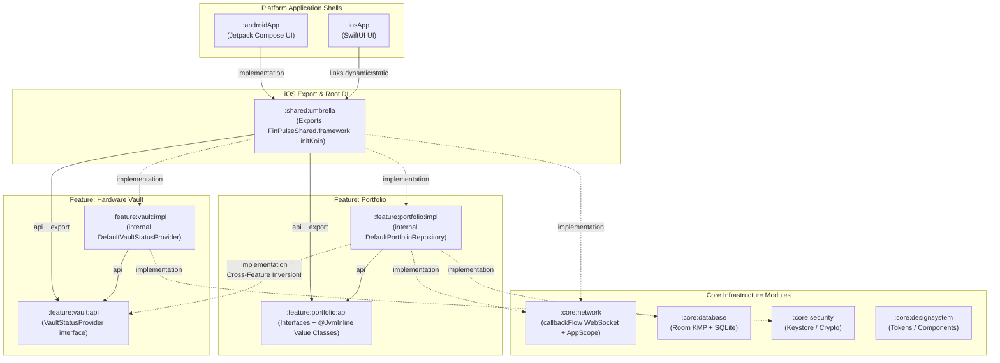

# FinPulse — Complete Android & KMP Engineering Interview Handbook
**Exhaustive Revision Guide: Phase 1 (Architecture, Gradle & KMP) & Phase 2 (Kotlin, Coroutines & Flows)**
*Structured progressively from **Level 1 (Core Engineer)** -> **Level 2 (Senior Engineer)** -> **Level 3 (Staff / Principal / Tech Lead)** so concepts build naturally on one another while studying.*

---

## 📑 Table of Contents
1. [Visual System Architecture & Block Diagrams](#1-visual-system-architecture--block-diagrams)
2. [Module 1: Multi-Module Architecture, Gradle & Dependency Injection (Phase 1)](#2-module-1-multi-module-architecture-gradle--dependency-injection-phase-1)
   - [Level 1: Core Engineer Foundations (Modularization, Gradle & DI Basics)](#21-level-1-core-engineer-foundations-modularization-gradle--di-basics)
   - [Level 2: Senior Engineer Deep Dive (Compilation Avoidance, Convention Plugins, Compile-Time DI)](#22-level-2-senior-engineer-deep-dive-compilation-avoidance-convention-plugins-compile-time-di)
   - [Level 3: Staff / Principal Architecture (KMP Internals, iOS Umbrella Binaries, Native GC & ARC)](#23-level-3-staff--principal-architecture-kmp-internals-ios-umbrella-binaries-native-gc--arc)
3. [Module 2: Advanced Kotlin Language & Type System (Phase 2A)](#3-module-2-advanced-kotlin-language--type-system-phase-2a)
   - [Level 1: Core Engineer Foundations (`data class`, `sealed`, `object`, Null-Safety)](#31-level-1-core-engineer-foundations-data-class-sealed-object-null-safety)
   - [Level 2: Senior Engineer Deep Dive (`inline`, `noinline`, `crossinline`, `reified`, Variance)](#32-level-2-senior-engineer-deep-dive-inline-noinline-crossinline-reified-variance)
   - [Level 3: Staff / Principal Internals (`@JvmInline value class`, Boxing Traps, Financial Math, Obj-C Headers)](#33-level-3-staff--principal-internals-jvminline-value-class-boxing-traps-financial-math-obj-c-headers)
4. [Module 3: Coroutines, Structured Concurrency & Dispatchers (Phase 2B)](#4-module-3-coroutines-structured-concurrency--dispatchers-phase-2b)
   - [Level 1: Core Engineer Foundations (`suspend`, Builders, Scopes, Dispatchers)](#41-level-1-core-engineer-foundations-suspend-builders-scopes-dispatchers)
   - [Level 2: Senior Engineer Deep Dive (CPS State Machine, Structured Concurrency, Exceptions, Cancellation)](#42-level-2-senior-engineer-deep-dive-cps-state-machine-structured-concurrency-exceptions-cancellation)
   - [Level 3: Staff / Principal Internals (`SupervisorJob` Traps, Thread Pool Sharing, Virtual Time Testing)](#43-level-3-staff--principal-internals-supervisorjob-traps-thread-pool-sharing-virtual-time-testing)
5. [Module 4: Reactive Streams — Kotlin Flow, Channels, `StateFlow` & `SharedFlow` (Phase 2C)](#5-module-4-reactive-streams--kotlin-flow-channels-stateflow--sharedflow-phase-2c)
   - [Level 1: Core Engineer Foundations (Cold vs Hot, Terminal Operators, `StateFlow` vs `SharedFlow` vs `LiveData`)](#51-level-1-core-engineer-foundations-cold-vs-hot-terminal-operators-stateflow-vs-sharedflow-vs-livedata)
   - [Level 2: Senior Engineer Deep Dive (`callbackFlow`, Backpressure, `flatMap*`, `flowOn`, Lifecycle Collection)](#52-level-2-senior-engineer-deep-dive-callbackflow-backpressure-flatmap-flowon-lifecycle-collection)
   - [Level 3: Staff / Principal Curveballs (`WhileSubscribed(5000, 0)`, `runningFold` vs `conflate`, Operator Fusion)](#53-level-3-staff--principal-curveballs-whilesubscribed5000-0-runningfold-vs-conflate-operator-fusion)
6. [Master Quick-Reference Cheat Sheet](#6-master-quick-reference-cheat-sheet)

---

## 1. Visual System Architecture & Block Diagrams

### 1.1 5-Tier Layered Architecture Block Diagram (Whiteboard Blueprint)

```
+===================================================================================================+
|                                LAYER 1: PLATFORM APPLICATION SHELLS                               |
|                                                                                                   |
|  +---------------------------------------------+   +-------------------------------------------+  |
|  |                 :androidApp                 |   |                   iosApp                  |  |
|  |  • FinPulseApplication (initKoin)           |   |  • FinPulseApp.swift (doInitKoin)         |  |
|  |  • MainActivity + Jetpack Compose UI        |   |  • SwiftUI ContentView + ViewModel        |  |
|  |  • Collects StateFlow (Lifecycle-aware)     |   |  • Collects via IosPortfolioBridge        |  |
|  +----------------------+----------------------+   +---------------------+---------------------+  |
+-------------------------|------------------------------------------------|------------------------+
                          | Gradle implementation                          | Links XCFramework
                          v                                                v
+===================================================================================================+
|                           LAYER 2: SHARED UMBRELLA & DI ROOT (:shared:umbrella)                   |
|                                                                                                   |
|  +---------------------------------------------------------------------------------------------+  |
|  | • Single iOS Binary Boundary: FinPulseShared.framework (avoids duplicate K/N runtimes)      |  |
|  | • Root DI Graph: initKoin() aggregates NetworkModule, VaultModule, PortfolioModule          |  |
|  | • iOS Coroutine Bridge (iosMain): IosPortfolioBridge + CloseableSubscription                |  |
|  | • Explicitly exports ONLY :feature:portfolio:api & :feature:vault:api to Objective-C/Swift  |  |
|  +----------------------+------------------------------------------------+---------------------+  |
+-------------------------|------------------------------------------------|------------------------+
                          |                                                |
                          v                                                v
+===================================================================================================+
|                         LAYER 3: FEATURE CONTRACT LAYER (:api Modules — Public ABI)               |
|                                                                                                   |
|  +---------------------------------------------+   +-------------------------------------------+  |
|  |            :feature:portfolio:api           |   |             :feature:vault:api            |  |
|  |  • PortfolioRepository (interface)          |   |  • VaultStatusProvider (interface)        |  |
|  |  • PortfolioStreamState (Locked/Active)     |   |    - val isVaultUnlocked: StateFlow<Bool> |  |
|  |  • @JvmInline value class TickerSymbol      |   |    - fun setVaultUnlocked(Boolean)        |  |
|  |  • @JvmInline value class PriceMicros       |   +-------------------------------------------+  |
|  |  • @JvmInline value class QuantityMicros    |                         ^                        |
|  +----------------------+----------------------+                         |                        |
+-------------------------|------------------------------------------------|------------------------+
                          | implements (api)      Cross-Feature Inversion  | depends on (impl)
                          |                       (@Provided via Koin KSP) |
+-------------------------|------------------------------------------------|------------------------+
|                         |   LAYER 4: FEATURE IMPLEMENTATION LAYER (:impl Modules — Zero Public ABI)|
|                         |                                                |                        |
|  +----------------------+----------------------+   +---------------------+---------------------+  |
|  |           :feature:portfolio:impl           |   |            :feature:vault:impl            |  |
|  |  • internal class DefaultPortfolioRepository|   |  • internal class DefaultVaultStatus-     |  |
|  |    - flatMapLatest(isVaultUnlocked)         |   |    Provider                               |  |
|  |    - retryWhen (exponential backoff)        |   |  • @Module class VaultModule              |  |
|  |    - runningFold -> conflate() -> flowOn()  |   |  • ZERO compile dependency on Portfolio!  |  |
|  |    - stateIn(WhileSubscribed(5_000L, 0L))   |   +-------------------------------------------+  |
|  |  • @Module class PortfolioModule            |                         |                        |
|  +----------------------+----------------------+                         |                        |
+-------------------------|------------------------------------------------|------------------------+
                          | implementation                                 | implementation
                          v                                                v
+===================================================================================================+
|                              LAYER 5: CORE INFRASTRUCTURE (:core Modules)                         |
|                                                                                                   |
|  +------------------------+  +-----------------------+  +------------------+  +----------------+  |
|  |     :core:network      |  |    :core:database     |  |  :core:security  |  | :core:design-  |  |
|  | • TickerSocketDataSrc  |  | • Room KMP 2.8+       |  | • Hardware Vault |  |   system       |  |
|  |   (callbackFlow +      |  | • BundledSQLiteDriver |  |   Keystore /     |  | • Shared Theme |  |
|  |    DROP_OLDEST[64] +   |  | • Offline-first cache |  |   Crypto engine  |  |   Tokens       |  |
|  |    awaitClose)         |  |   (Phase 4)           |  |   (Phase 5)      |  |                |  |
|  | • NetworkModule        |  +-----------------------+  +------------------+  +----------------+  |
|  |   (App SupervisorScope)|                                                                       |
|  +------------------------+                                                                       |
+===================================================================================================+
|                       FOUNDATION: GRADLE COMPOSITE BUILD (:build-logic:convention)                |
|  • finpulse.kmp.library (AGP 9+ com.android.kotlin.multiplatform.library, JVM 17, iOS Arm64)      |
|  • finpulse.kmp.koin (KSP + KOIN_CONFIG_CHECK = true compile-time graph verification)             |
|  • finpulse.kmp.feature.impl (Standardizes feature :impl conventions)                             |
+===================================================================================================+
```

---

### 1.2 End-to-End Runtime Data & Concurrency Block Diagram (Phase 2)

```
+---------------------------------------------------------------------------------------------------+
|                                   :core:network (Background Thread)                               |
|                                                                                                   |
|  [SimulatedRealtimeSocketClient]  --(20Hz / 50ms ticks)-->  [DefaultTickerSocketDataSource]       |
|   • CoroutineScope(Dispatchers.Default)                      • callbackFlow { ... }               |
|   • Rethrows CancellationException!                          • trySend(rawTick) (non-blocking)    |
|                                                              • Channel(64, DROP_OLDEST)           |
|                                                              • awaitClose { socket.disconnect() } |
+---------------------------------------------------------------------------------+-----------------+
                                                                                  |
                                                           Cold Flow<RawTickerTickDto>
                                                                                  |
                                                                                  v
+---------------------------------------------------------------------------------------------------+
|                                :feature:portfolio:impl (Repository Pipeline)                      |
|                                                                                                   |
|  [VaultStatusProvider.isVaultUnlocked]                                                            |
|                 |                                                                                 |
|                 v                                                                                 |
|         +---------------+     false (Vault Locked!)                                               |
|         | flatMapLatest | -----------------------------> Emits PortfolioStreamState.Locked        |
|         +---------------+                                (Cancels callbackFlow -> awaitClose!)    |
|                 | true (Vault Unlocked)                                                           |
|                 v                                                                                 |
|         +---------------+                                                                         |
|         |   retryWhen   | --> Exponential backoff: min(10s, 500ms * 2^attempt)                    |
|         +---------------+                                                                         |
|                 |                                                                                 |
|                 v                                                                                 |
|         +---------------+                                                                         |
|         |  runningFold  | --> Accumulates single-symbol tick into Map<String, AssetHolding>       |
|         +---------------+     (Unboxed @JvmInline PriceMicros & QuantityMicros)                   |
|                 |                                                                                 |
|                 v                                                                                 |
|         +---------------+                                                                         |
|         |   conflate()  | --> Coalesces full snapshots if downstream UI is busy rendering frame   |
|         +---------------+                                                                         |
|                 |                                                                                 |
|                 v                                                                                 |
|         +---------------+                                                                         |
|         |    flowOn     | --> Executes upstream accumulation on DefaultDispatcher                 |
|         +---------------+                                                                         |
|                 |                                                                                 |
|                 v                                                                                 |
|  +---------------------------------------------------------------------------------------------+  |
|  | stateIn(scope = AppSupervisorScope, started = WhileSubscribed(5_000L, 0L), Connecting)      |  |
|  |  • Rotation (< 5s): Keeps WebSocket alive; replays latest Active snapshot immediately       |  |
|  |  • Background (> 5s): Stops upstream (closes socket) & resets cache to Connecting (0L)      |  |
|  +----------------------------------------------+----------------------------------------------+  |
+-------------------------------------------------|-------------------------------------------------+
                                                  |
                         Hot StateFlow<PortfolioStreamState>
                                                  |
                       +--------------------------+--------------------------+
                       |                                                     |
                       v                                                     v
     +-----------------------------------+                 +-----------------------------------+
     |     Android (MainActivity.kt)     |                 |     iOS (FinPulseApp.swift)       |
     | • collectAsState() in Compose     |                 | • IosPortfolioBridge (MainScope)  |
     | • Renders Active / Locked Cards   |                 | • SwiftUI @Published state        |
     +-----------------------------------+                 +-----------------------------------+
```

---

### 1.3 Mermaid Dependency Graph & ABI Boundary Diagram



---

## 2. Module 1: Multi-Module Architecture, Gradle & Dependency Injection (Phase 1)

*Study Order: Start with why we modularize and basic Gradle scopes (Level 1), move to how Gradle optimizes builds and how Koin KSP works (Level 2), and finish with KMP iOS framework internals (Level 3).*

---

### 2.1 Level 1: Core Engineer Foundations (Modularization, Gradle & DI Basics)

#### Q1.1 [Engineer]: Why do we modularize an Android/KMP app instead of keeping everything in a single `:app` monolith?
**Answer:**
1. **Build Speed & Parallelism:** Gradle compiles independent modules in parallel across CPU cores and caches unchanged modules (`UP-TO-DATE` / Remote Build Cache). In a monolith, changing 1 file recompiles the whole module.
2. **Strict Architectural Boundaries:** In a monolith, any package can import any other package unless policed by lint rules. With modules, circular dependencies are rejected by Gradle at configuration time, and `internal` classes cannot be accessed outside their module.
3. **Clear Ownership:** Feature teams (e.g., Portfolio vs. Vault) own distinct modules with minimal merge conflicts.
4. **Reusability & Dynamic Delivery:** Enables sharing `:core` or `:feature` modules across Android, iOS, Wear OS, or Instant Apps.

---

#### Q1.2 [Engineer]: What is the difference between `implementation`, `api`, and `compileOnly` in Gradle?
**Answer:**
* **`implementation`:** The dependency is available to the current module at **compile time** and **runtime**, but its types are **hidden** from the compile classpath of any downstream module that depends on the current module. (Default and preferred for 95% of dependencies).
* **`api`:** The dependency is available at compile time and runtime, **AND** its types are transitively exposed on the compile classpath of any downstream module. Use `api` **only** when a type from that dependency appears in your module's public method signatures/interfaces (e.g., `:feature:portfolio:impl` uses `api(projects.feature.portfolio.api)` because it implements `PortfolioRepository`).
* **`compileOnly`:** Available only at compile time; excluded from the final APK/binary at runtime (used for compile-only annotations or libraries provided by the host environment).

---

#### Q1.3 [Engineer]: What is a Version Catalog (`libs.versions.toml`) and what are Type-Safe Project Accessors?
**Answer:**
* **Version Catalog ([`gradle/libs.versions.toml`](file:///Users/swati/AndroidStudioProjects/FinPulse/gradle/libs.versions.toml)):** Centralizes all `[versions]`, `[libraries]`, and `[plugins]` in one declarative TOML file exposed as type-safe `libs.*` accessors across both the main project and `build-logic`.
* **Type-Safe Project Accessors (`enableFeaturePreview("TYPESAFE_PROJECT_ACCESSORS")` in [`settings.gradle.kts`](file:///Users/swati/AndroidStudioProjects/FinPulse/settings.gradle.kts)):** Replaces error-prone string references like `project(":feature:portfolio:api")` with IDE-autocompleted, compile-time checked accessors: `projects.feature.portfolio.api`.

---

#### Q1.4 [Engineer]: What is the difference between Dependency Injection (Hilt/Dagger) and a Service Locator (traditional Koin)? And what is `@Single` vs `@Factory` vs `scoped`?
**Answer:**
* **Dependency Injection (DI) vs Service Locator:**
  * In pure **DI**, classes declare dependencies in their constructor (`class DefaultPortfolioRepository(val vault: VaultStatusProvider)`), and an external assembler pushes those dependencies in. The class never reaches out to a global container.
  * In a **Service Locator**, a class actively pulls dependencies from a global registry (`val repo = KoinPlatform.getKoin().get<PortfolioRepository>()`).
  * *How FinPulse uses Koin:* Inside all `:feature` and `:core` modules, we use **pure Constructor DI** via Koin Annotations (`@Single`). We only use `by inject()` at the platform entry boundary ([`MainActivity.kt`](file:///Users/swati/AndroidStudioProjects/FinPulse/androidApp/src/main/kotlin/com/finpulse/android/MainActivity.kt) and [`IosPortfolioBridge.kt`](file:///Users/swati/AndroidStudioProjects/FinPulse/shared/umbrella/src/iosMain/kotlin/com/finpulse/shared/umbrella/IosPortfolioBridge.kt)) where the OS instantiates the class.
* **Scopes:**
  * **`@Single` (`single`):** Singleton instance created once and retained for the lifetime of the Koin container.
  * **`@Factory` (`factory`):** Creates a brand-new instance every time it is requested; never cached.
  * **`@Scoped` (`scoped`):** Singleton tied to a bounded lifecycle (e.g., an Activity, a logged-in User session, or a checkout flow) that is destroyed when the scope closes.

---

#### Q1.5 [Engineer]: How do Kotlin visibility modifiers (`public`, `internal`, `protected`, `private`) work, and how does `internal` differ from Java's package-private?
**Answer:**
* **`public` (Default in Kotlin):** Visible everywhere.
* **`private`:** Visible only inside the same class (or same file for top-level declarations).
* **`protected`:** Visible to the class and its subclasses (Note: unlike Java, Kotlin `protected` is **not** visible to other classes in the same package!).
* **`internal`:** Visible anywhere **inside the same Gradle module / compilation unit** (`:feature:portfolio:impl`), regardless of package name, but **invisible** to other Gradle modules.
* **Why `internal` is better than Java's package-private for modular architecture:** In Java, anyone in another module could bypass package-private encapsulation simply by declaring the same package name (`package com.finpulse.feature.portfolio.impl;`). Kotlin's `internal` enforces encapsulation at the **compiler module boundary**.

---

### 2.2 Level 2: Senior Engineer Deep Dive (Compilation Avoidance, Convention Plugins, Compile-Time DI)

#### Q1.6 [Senior]: How does Gradle Compilation Avoidance (ABI) work, and why do we split features into `:api` and `:impl` modules?
**Answer:**
1. **What is ABI (Application Binary Interface)?**
   * A module's ABI consists of its public class names, public/protected method signatures, return types, and properties. Private method bodies and `internal` classes (for Kotlin consumers) are excluded from the public contract.
2. **The Cascade Problem Without `:api` / `:impl`:**
   * Suppose `:feature:portfolio` directly depended on `:feature:vault`. Every time a developer modified code inside `:feature:vault`, Gradle would have to wait for `:feature:vault` to finish compiling and potentially recompile `:feature:portfolio`.
3. **How `:api` + `:impl` Achieves Compilation Avoidance:**
   * `:feature:vault:api` contains only the tiny [`VaultStatusProvider`](file:///Users/swati/AndroidStudioProjects/FinPulse/feature/vault/api/src/commonMain/kotlin/com/finpulse/feature/vault/api/VaultStatusProvider.kt) interface (which rarely changes).
   * `:feature:portfolio:impl` depends **only** on `:feature:vault:api` via `implementation(projects.feature.vault.api)` ([`feature/portfolio/impl/build.gradle.kts`](file:///Users/swati/AndroidStudioProjects/FinPulse/feature/portfolio/impl/build.gradle.kts)).
   * When a developer edits [`DefaultVaultStatusProvider`](file:///Users/swati/AndroidStudioProjects/FinPulse/feature/vault/impl/src/commonMain/kotlin/com/finpulse/feature/vault/impl/DefaultVaultStatusProvider.kt) in `:feature:vault:impl`, `:feature:vault:api`'s ABI is untouched. Therefore:
     1. `:feature:portfolio:impl` is marked `UP-TO-DATE` (zero recompilation).
     2. `:feature:portfolio:impl` and `:feature:vault:impl` can compile **100% in parallel**.

> [!TIP]
> **Interview Soundbite:**
> *"Splitting features into `:api` and `:impl` decouples the dependency graph into a flat star topology instead of a deep chain. Because `:impl` modules only depend on other features' `:api` modules via `implementation`, and all classes inside `:impl` are `internal`, modifying an `:impl` module never invalidates the ABI of any other feature module."*

---

#### Q1.7 [Senior]: Why did we use a Gradle Composite Build (`includeBuild("build-logic")`) with Convention Plugins instead of `buildSrc`?
**Answer:**
* **`buildSrc` Cache Invalidation:** Gradle treats `buildSrc` as an implicit dependency of the root build classpath. Editing a single line in `buildSrc` invalidates the **entire project's build cache** and forces every module's tasks to re-run.
* **Composite Build (`build-logic`) Isolation:** `includeBuild("build-logic")` ([`settings.gradle.kts`](file:///Users/swati/AndroidStudioProjects/FinPulse/settings.gradle.kts)) is an independent build that produces standard Gradle plugins (`finpulse.kmp.library`, `finpulse.kmp.koin`, `finpulse.kmp.feature.impl`). Only modules that apply a specific modified plugin are affected, and `build-logic` works seamlessly with Gradle Configuration Cache.

---

#### Q1.8 [Senior]: How does Koin Annotations (KSP) with `KOIN_CONFIG_CHECK = true` work, and why did we need `@Provided` on `VaultStatusProvider`?
**Answer:**
1. **Compile-Time Verification (`KOIN_CONFIG_CHECK = true`):**
   * In [`KmpKoinConventionPlugin.kt`](file:///Users/swati/AndroidStudioProjects/FinPulse/build-logic/convention/src/main/kotlin/com/finpulse/buildlogic/KmpKoinConventionPlugin.kt#L39-L42), we pass `arg("KOIN_CONFIG_CHECK", "true")` to KSP.
   * During `kspCommonMainKotlinMetadata`, Koin's KSP processor scans every `@Single` / `@Factory` constructor in the module and verifies that every parameter type has a matching provider in that module or its included `@Module(includes = [...])` modules. If a binding is missing, **compilation fails immediately** (just like Dagger/Hilt).
2. **Why `@Provided` was required in [`DefaultPortfolioRepository.kt`](file:///Users/swati/AndroidStudioProjects/FinPulse/feature/portfolio/impl/src/commonMain/kotlin/com/finpulse/feature/portfolio/impl/DefaultPortfolioRepository.kt#L58):**
   * `DefaultPortfolioRepository` injects `VaultStatusProvider` (from `:feature:vault:api`).
   * Because `:feature:portfolio:impl` intentionally does **not** depend on `:feature:vault:impl`, KSP compiling `:feature:portfolio:impl` cannot see `VaultModule` (where `DefaultVaultStatusProvider` is bound).
   * Annotating `@Provided private val vaultStatusProvider: VaultStatusProvider` tells Koin KSP: *"This interface comes from a cross-module `:api` boundary and will be assembled at the root `:shared:umbrella` graph."*

---

#### Q1.9 [Senior]: When should you use `expect` / `actual` in KMP versus a standard Kotlin `interface` with Dependency Injection?
**Answer:**
* **Default to `interface` + Koin DI (90% of cases):**
  * `expect` / `actual` is a **static compile-time binding**—you cannot swap an `actual class` with a Fake or Mock in `commonTest`!
  * Defining `interface VaultStatusProvider` in `commonMain` lets you inject `DefaultVaultStatusProvider` in production and `FakeVaultStatusProvider` in [`DefaultPortfolioRepositoryTest`](file:///Users/swati/AndroidStudioProjects/FinPulse/feature/portfolio/impl/src/commonTest/kotlin/com/finpulse/feature/portfolio/impl/DefaultPortfolioRepositoryTest.kt).
* **Use `expect` / `actual` ONLY for (10% of cases):**
  * Platform `typealias`es, low-level value wrappers, top-level platform helpers, or framework-required declarations like Room KMP's `expect object AppDatabaseConstructor : RoomDatabaseConstructor<AppDatabase>`.

---

### 2.3 Level 3: Staff / Principal Architecture (KMP Internals, iOS Umbrella Binaries, Native GC & ARC)

#### Q1.10 [Staff/Principal]: Why must an iOS app link only ONE KMP Umbrella Framework (`:shared:umbrella`) instead of importing each KMP Gradle module as a separate `.framework`?
**Answer:**
1. **Closed-World Compilation Model:** Unlike the JVM (which loads `.class` files dynamically into a single shared JVM runtime), Kotlin/Native uses a closed-world compiler that bundles the Kotlin runtime, memory manager/GC, `kotlin-stdlib`, and `kotlinx.coroutines` directly into each produced `.framework` binary.
2. **3 Fatal Consequences of Multiple KMP Frameworks on iOS:**
   * **Binary Size Duplication:** Every `.framework` duplicates the Kotlin runtime and stdlib (+10–30 MB per framework).
   * **Broken Runtime Type Identity:** Each framework has its own isolated Objective-C class table and Kotlin type metadata. An `AssetHolding` or `StateFlow` created in Framework A fails `is` type checks when passed into Framework B!
   * **Split Coroutine Dispatchers & Singletons:** `Dispatchers.Main` and `object` singletons exist as separate copies in each framework.
3. **The Umbrella Pattern ([`shared/umbrella/build.gradle.kts`](file:///Users/swati/AndroidStudioProjects/FinPulse/shared/umbrella/build.gradle.kts)):**
   * Only `:shared:umbrella` configures `iosTarget.binaries.framework { baseName = "FinPulseShared" }`, pulling all `:impl` and `:core` modules into one unified Mach-O binary while using `export(...)` to expose only `:api` contracts to Swift.

---

#### Q1.11 [Staff/Principal]: Why did `:shared:umbrella` need BOTH `api(projects.feature.portfolio.api)` AND `export(projects.feature.portfolio.api)`? And what is the trade-off between `isStatic = true` and `isStatic = false`?
**Answer:**
1. **`api(...)` vs `export(...)`:**
   * To keep generated Objective-C headers (`FinPulseShared.h`) small and fast for Xcode to parse, Kotlin/Native's header generator only emits full Objective-C interfaces for declarations inside `:shared:umbrella` itself. Transitive `api(...)` dependencies are emitted only as `@class` forward declarations unless explicitly listed in `export(...)`.
   * By `export`-ing only `:feature:portfolio:api` and `:feature:vault:api`, we keep `:impl` and `:core` completely invisible to Swift!
2. **Static (`isStatic = true`) vs Dynamic (`isStatic = false`) iOS Frameworks:**
   * **Static (`isStatic = true`):** Linked directly into the main iOS app executable at build time. Faster cold app startup (no `dyld` dynamic library loading overhead at launch), **but** requires the host Xcode project to manually pass C-interop system linker flags (like `-lsqlite3` for Room/SQLite) in `Other Linker Flags`.
   * **Dynamic (`isStatic = false`):** Linked as a self-contained dynamic library embedded in `FinPulse.app/Frameworks/`. Resolves its own C-interop symbols (`sqlite3`, etc.) automatically at framework link time and can be shared across the main iOS app and iOS Widget Extensions without duplicating binary size.

---

#### Q1.12 [Staff/Principal]: How does Kotlin/Native's modern Memory Manager / Garbage Collector interact with iOS's Swift ARC, and how do cross-runtime memory leaks happen?
**Answer:**
* **Legacy vs Modern K/N Memory Model:**
  * Pre-Kotlin 1.7.20 required `freeze()` to share objects across threads (throwing `InvalidMutabilityException` if mutated).
  * Modern Kotlin/Native (Kotlin 2.x) uses a shared-heap **tracing Garbage Collector** (concurrent mark & sweep), allowing objects created on `Dispatchers.Default` to be freely read on `Dispatchers.Main` in SwiftUI.
* **The Cross-Runtime Reference Cycle Trap (Kotlin GC <-> Swift ARC):**
  * Swift uses deterministic reference counting (**ARC**), while Kotlin/Native uses a **tracing GC**.
  * If a Swift `ObservableObject` (`PortfolioViewModel`) holds a strong reference to a Kotlin object/subscription, AND the Kotlin coroutine holds a strong reference to a Swift closure that strongly captures `self`, **neither runtime can break the cycle** (ARC sees refCount > 0 from Kotlin; Kotlin GC sees an external root from Objective-C ARC).
  * **Prevention (in [`FinPulseApp.swift`](file:///Users/swati/AndroidStudioProjects/FinPulse/iosApp/FinPulseApp.swift)):** Always capture `[weak self]` inside closures passed from Swift into Kotlin, and expose a deterministic [`CloseableSubscription.close()`](file:///Users/swati/AndroidStudioProjects/FinPulse/shared/umbrella/src/iosMain/kotlin/com/finpulse/shared/umbrella/IosPortfolioBridge.kt#L24-L26) called in `.onDisappear` / `deinit`.

---

## 3. Module 2: Advanced Kotlin Language & Type System (Phase 2A)

*Study Order: Master how Kotlin classes compile to JVM bytecode (Level 1), then how `inline` and `reified` eliminate lambda overhead and type erasure (Level 2), and finally how `@JvmInline value class` achieves zero-allocation domain modeling (Level 3).*

---

### 3.1 Level 1: Core Engineer Foundations (`data class`, `sealed`, `object`, Null-Safety)

#### Q2.1 [Engineer]: What does the Kotlin compiler generate for a `data class` like `AssetHolding`, and what are the pitfalls of using arrays or mutable properties inside a `data class`?
**Answer:**
* **Compiler-Generated Methods:** For all properties declared in the **primary constructor**, the compiler generates:
  1. `equals(other: Any?)` & `hashCode()`
  2. `toString()`
  3. `copy(...)` (shallow copy!)
  4. `component1()`, `component2()`, ... (for destructuring declarations: `val (symbol, name) = holding`)
* **Pitfall 1 (Properties in Class Body):** Any property declared inside the `{ ... }` body (like `val totalValueUsd: Double` in [`AssetHolding`](file:///Users/swati/AndroidStudioProjects/FinPulse/feature/portfolio/api/src/commonMain/kotlin/com/finpulse/feature/portfolio/api/PortfolioModels.kt#L55)) is **excluded** from `equals()`, `hashCode()`, and `copy()`.
* **Pitfall 2 (`ByteArray` / `Array<T>` in `data class`):** In JVM/Kotlin, `Array.equals` checks **referential identity (`===`)**, not structural contents (`contentEquals`). If a `data class` holds a `ByteArray` (e.g., cryptographic keys in Phase 5), you **must** override `equals()` and `hashCode()` using `contentEquals()` / `contentHashCode()`, otherwise `StateFlow` will think two identical byte arrays are unequal!
* **Pitfall 3 (`var` in `data class`):** Mutating a `var` property after inserting a `data class` as a key in a `HashMap` or `HashSet` changes its `hashCode()`, corrupting the hash bucket lookup.

---

#### Q2.2 [Engineer]: What is the difference between a `sealed interface`, a `sealed class`, and an `enum class`? Why did we use `sealed interface PortfolioStreamState` and `data object`?
**Answer:**
* **`enum class`:** Each variant is a single static instance with the exact same schema. Cannot hold per-instance state (like `Active(val holdings: List<AssetHolding>)`).
* **`sealed class` vs `sealed interface`:**
  * Both restrict all direct subtypes to be known at compile time within the same package/module, enabling exhaustive `when (state)` expressions without an `else` branch.
  * **`sealed class`** can hold constructor state/backing fields, but a subclass can only extend **one** class (single inheritance).
  * **`sealed interface`** ([`PortfolioStreamState`](file:///Users/swati/AndroidStudioProjects/FinPulse/feature/portfolio/api/src/commonMain/kotlin/com/finpulse/feature/portfolio/api/PortfolioModels.kt#L59)) has no constructor/backing fields, has no extra superclass constructor call in bytecode, and allows a class/object to implement **multiple** sealed interfaces (e.g., a state or error belonging to two hierarchies).
* **Why `data object Locked` instead of `object Locked`?**
  * A plain `object Locked` inherits `Any.toString()`, printing ugly memory addresses like `PortfolioStreamState$Locked@4f3bc2`.
  * `data object Locked` generates a clean `toString()` (`"Locked"`) and proper `equals`/`hashCode` symmetry for serialization and test assertions!

---

#### Q2.3 [Engineer]: What is the difference between `val`, `const val`, `@JvmField`, and `lateinit var` vs `by lazy`?
**Answer:**
* **`val`:** Read-only property (generates a backing field + a getter method `getFoo()`). Note: `val` does *not* mean immutable if it has a custom `get()`!
* **`const val`:** Compile-time constant (only allowed for primitives and `String` at top-level or inside an `object`). Inlined directly into call sites at compile time with zero method call overhead (e.g., `const val APP_COROUTINE_SCOPE = "AppCoroutineScope"` in [`NetworkModule.kt`](file:///Users/swati/AndroidStudioProjects/FinPulse/core/network/src/commonMain/kotlin/com/finpulse/core/network/di/NetworkModule.kt#L12)).
* **`lateinit var` vs `by lazy`:**
  * `lateinit var`: Mutable (`var`), non-nullable, non-primitive type initialized later (e.g., in `onCreate` or DI). Throws `UninitializedPropertyAccessException` if read before assignment.
  * `by lazy`: Immutable (`val`), computed on first read and cached. By default uses `LazyThreadSafetyMode.SYNCHRONIZED` (thread-safe double-checked locking); on main-thread-only code you can pass `LazyThreadSafetyMode.NONE` to skip lock overhead.

---

### 3.2 Level 2: Senior Engineer Deep Dive (`inline`, `noinline`, `crossinline`, `reified`, Variance)

#### Q2.4 [Senior]: How do `inline`, `noinline`, `crossinline`, and `reified` work under the hood in Kotlin?
**Answer:**
1. **Why Higher-Order Functions Allocate Memory Without `inline`:**
   * Normally, passing a lambda `filter { it.price > 100 }` compiles to an anonymous `Function1` class instance on the heap (and captures local variables into a closure object). Inside a 60fps loop or high-frequency stream, this causes GC pressure.
2. **What `inline` Does:**
   * The compiler copies the bytecode of the `inline` function AND the bytecode of the passed lambda directly into the call site—**zero `Function1` object allocation** and enables **non-local `return`s** (returning from the enclosing function directly from inside the lambda).
   * *Note:* Every Kotlin Flow operator (`map`, `filter`, `flatMapLatest`, `runningFold`, `collect`) is an `inline` function!
3. **`noinline`:**
   * Marks a specific lambda parameter of an `inline` function so it is *not* inlined—required if you need to store that lambda in a variable or pass it to a non-inline function.
4. **`crossinline`:**
   * Keeps the lambda inlined, **but forbids non-local `return`s**. Required when the `inline` function invokes the lambda inside a *different execution context* (such as inside a `Runnable`, callback, or nested object where a non-local `return` to the outer function is impossible).
5. **`reified` Type Parameters (`inline fun <reified T> ...`):**
   * On the JVM, generic types (`<T>`) are erased at compile time (`List<String>` becomes `List`), so you cannot write `if (x is T)` or `T::class`.
   * Marking an `inline` function's type parameter `reified` instructs the compiler to replace `T` with the actual concrete class literal (e.g., `PortfolioStreamState.Active::class`) directly in the inlined bytecode at every call site! (That's how `assertIs<PortfolioStreamState.Active>(item)` in [`DefaultPortfolioRepositoryTest.kt`](file:///Users/swati/AndroidStudioProjects/FinPulse/feature/portfolio/impl/src/commonTest/kotlin/com/finpulse/feature/portfolio/impl/DefaultPortfolioRepositoryTest.kt#L87) and Koin's `by inject<PortfolioRepository>()` work!).

---

#### Q2.5 [Senior]: Explain Generics Variance in Kotlin: `out` (Covariance) vs `in` (Contravariance) vs Invariance. Why is `Flow<out T>` covariant?
**Answer:**
* **Invariance (`MutableList<T>`):** Neither a producer nor consumer exclusively. `MutableList<Dog>` is **NOT** a subtype of `MutableList<Animal>` (because someone could insert a `Cat` into it).
* **Covariance (`out T` — Producer):** `T` only ever comes **out** as a return type (never passed in as a parameter). `List<out T>`, `Flow<out T>`, and `StateFlow<out T>` are covariant!
  * This is why in [`DefaultPortfolioRepository.kt`](file:///Users/swati/AndroidStudioProjects/FinPulse/feature/portfolio/impl/src/commonMain/kotlin/com/finpulse/feature/portfolio/impl/DefaultPortfolioRepository.kt#L110), `flowOf(PortfolioStreamState.Locked)` (`Flow<PortfolioStreamState.Locked>`) is automatically a valid `Flow<PortfolioStreamState>` without casting!
* **Contravariance (`in T` — Consumer):** `T` only ever goes **in** as a function argument (`Comparable<in T>`, `FlowCollector<in T>`). A `Comparator<Animal>` can safely compare two `Dog`s, so `Comparator<Animal>` is a subtype of `Comparator<Dog>`.

---

### 3.3 Level 3: Staff / Principal Internals (`@JvmInline value class`, Boxing Traps, Financial Math, Obj-C Headers)

#### Q2.6 [Staff/Principal]: Why did we model `TickerSymbol`, `PriceMicros`, and `QuantityMicros` as `@JvmInline value class` in [`PortfolioModels.kt`](file:///Users/swati/AndroidStudioProjects/FinPulse/feature/portfolio/api/src/commonMain/kotlin/com/finpulse/feature/portfolio/api/PortfolioModels.kt)? And why use `Long` micro-USD instead of `Double` or `BigDecimal`?
**Answer:**
1. **Why not `Double` for financial prices?**
   * `Double` uses IEEE 754 base-2 floating point, which cannot represent base-10 decimals like `0.1` or `0.01` exactly (`0.1 + 0.2 = 0.30000000000000004`), causing penny rounding bugs.
2. **Why not `BigDecimal` in a high-frequency KMP stream?**
   * `java.math.BigDecimal` is JVM-only (not available in `commonMain`).
   * Even with a 3rd-party KMP `BigDecimal`, every tick allocates heap objects. At 100 ticks/sec across 50 assets, that allocates 300,000 objects/minute, causing GC pauses and dropped UI frames.
3. **Why `@JvmInline value class PriceMicros(val micros: Long)`?**
   * **Exact Fixed-Point Precision:** 1 USD = `1,000,000` micro-USD stored in a 64-bit signed `Long` (supports up to `\$9.22 trillion` with 6 decimal places of precision).
   * **Zero Heap Allocation + Compile-Time Type Safety:** You cannot accidentally pass `QuantityMicros` into a parameter expecting `PriceMicros`, yet at compile time the Kotlin compiler **erases** the wrapper class and stores a raw 64-bit primitive `long` directly inside `AssetHolding`!

---

#### Q2.7 [Staff/Principal]: What are the 3 Boxing Traps where `@JvmInline value class` STILL allocates a heap object? And how does it behave across the iOS Objective-C / Swift boundary?
**Answer:**
1. **The 3 JVM/Native Boxing Traps:**
   A `@JvmInline value class` is **boxed** into a heap wrapper object whenever it is used as:
   * **A Nullable type:** `val price: PriceMicros?` (because a primitive `long` cannot hold `null`).
   * **A Generic type argument:** `List<PriceMicros>`, `Flow<PriceMicros>`, `Map<TickerSymbol, PriceMicros>` (because JVM generics erase to `Object`).
   * **An Interface type:** Assigning `PriceMicros` to an interface `val m: MonetaryValue = PriceMicros(100L)`.
   * *How we avoided boxing in FinPulse:* Inside [`AssetHolding`](file:///Users/swati/AndroidStudioProjects/FinPulse/feature/portfolio/api/src/commonMain/kotlin/com/finpulse/feature/portfolio/api/PortfolioModels.kt#L48-L55), `val livePrice: PriceMicros` and `val quantity: QuantityMicros` are non-null concrete fields inside a class—so they compile to unboxed primitive `long` fields!
2. **Why JVM methods taking value classes have mangled names (`calculate-<hash>`):**
   * Because `fun setPrice(p: PriceMicros)` erases to `setPrice(long)`, it would collide with `fun setPrice(p: Long)`. Kotlin mangles the bytecode name (`setPrice-xxxx(long)`) both to prevent signature clashes and to prevent Java callers from bypassing `PriceMicros`'s `init { require(...) }` validation!
3. **Objective-C / Swift Interop Behavior:**
   * In `FinPulseShared.h`, `PriceMicros(val micros: Long)` exports as raw `int64_t` (`Int64`), while `TickerSymbol(val value: String)` exports as `id` (`Any`), and value class member properties (`.usd`) are not attached to `Int64`.
   * That is why we added `symbolCode: String`, `quantityUnits: Double`, and `livePriceUsd: Double` directly on `AssetHolding` for clean SwiftUI bindings.

---

## 4. Module 3: Coroutines, Structured Concurrency & Dispatchers (Phase 2B)

*Study Order: Understand what `suspend` and Coroutine Builders do (Level 1), then how the compiler lowers `suspend` into a CPS state machine and how exceptions/cancellation propagate (Level 2), and finally master the `SupervisorJob` and Dispatcher thread-pool internals (Level 3).*

---

### 4.1 Level 1: Core Engineer Foundations (`suspend`, Builders, Scopes, Dispatchers)

#### Q3.1 [Engineer]: What is a Coroutine, how does it differ from an OS Thread, and what does the `suspend` keyword actually do?
**Answer:**
* **OS Thread vs Coroutine:**
  * An **OS Thread** is managed by the operating system kernel, allocates ~1–2 MB of stack memory, and requires an expensive kernel context switch to pause/resume. Blocking an OS thread (`Thread.sleep`) wastes that entire thread.
  * A **Coroutine** is a lightweight user-space computation (~a few hundred bytes on the heap) multiplexed over a small pool of OS threads. Thousands of coroutines can run on 4–8 OS threads.
* **What `suspend` does (and does NOT do):**
  * Marking a function `suspend` does **NOT** automatically move it to a background thread!
  * It simply marks that the function can **pause (suspend)** its execution at suspension points without blocking the underlying OS thread, and **resume** later (on the same or another thread) when the result is ready.

---

#### Q3.2 [Engineer]: Compare the 4 Coroutine Builders: `launch`, `async`, `withContext`, and `runBlocking`.
**Answer:**
| Builder | Suspends Current Coroutine? | Return Type | Primary Use Case |
| :--- | :--- | :--- | :--- |
| **`launch`** | **No** (launches concurrently in a `CoroutineScope`) | `Job` | Fire-and-forget work (starting UI state collection, triggering a state update). |
| **`async`** | **No** (launches concurrently in a `CoroutineScope`) | `Deferred<T>` | Running **2+ independent tasks in parallel** and combining them with `awaitAll()` / `.await()`. |
| **`withContext`** | **Yes** (sequential suspension in the current coroutine) | `T` (the lambda result) | Switching dispatchers for a single operation (e.g., `withContext(Dispatchers.Default) { parseJson() }`). **Never use `async { ... }.await()` sequentially when `withContext` suffices!** |
| **`runBlocking`** | **Blocks the calling OS thread** until completion | `T` | Bridging non-coroutine worlds (`fun main()`) or legacy JUnit4 tests. **NEVER call on `Dispatchers.Main` (causes instant ANR/deadlock)!** |

---

#### Q3.3 [Engineer]: Compare the 4 standard `CoroutineDispatcher`s (`Main`, `IO`, `Default`, `Unconfined`).
**Answer:**
* **`Dispatchers.Main`:** Android's single UI thread (`Looper.getMainLooper()`) or iOS's main run loop (`dispatch_get_main_queue()`). Used for UI updates and lightweight state coordination.
* **`Dispatchers.Default`:** Backed by a fixed-size thread pool equal to the number of CPU cores (`max(2, CPU_CORES)`). Used for **CPU-intensive work**: sorting large lists, JSON serialization, diffing, or our [`DefaultPortfolioRepository`](file:///Users/swati/AndroidStudioProjects/FinPulse/feature/portfolio/impl/src/commonMain/kotlin/com/finpulse/feature/portfolio/impl/DefaultPortfolioRepository.kt) `.runningFold` accumulation.
* **`Dispatchers.IO`:** Backed by an elastic thread pool (up to `max(64, CPU_CORES)` threads). Used for **blocking I/O**: disk reads/writes, Room queries, file system operations, or blocking network sockets where threads spend most of their time waiting.
* **`Dispatchers.Unconfined`:** Starts executing on the caller's current thread until the first suspension point, and after suspension resumes on whatever thread the suspending function used to resume the `Continuation`. Rarely used in production outside tests.

---

### 4.2 Level 2: Senior Engineer Deep Dive (CPS State Machine, Structured Concurrency, Exceptions, Cancellation)

#### Q3.4 [Senior]: How does the Kotlin compiler compile a `suspend` function under the hood (Continuation-Passing Style / CPS)?
**Answer:**
1. **Signature Transformation:**
   * The compiler removes the `suspend` keyword, adds an extra parameter `completion: Continuation<T>` at the end of the parameter list, and changes the return type to `Any?` (because the function can return either the actual result `T` synchronously OR the special marker `COROUTINE_SUSPENDED`).
   * Example: `suspend fun fetchQuote(symbol: String): PriceMicros` compiles to:
     `fun fetchQuote(symbol: String, completion: Continuation<PriceMicros>): Any?`
2. **State Machine Generation (Switch on `label`):**
   * Rather than allocating a new callback lambda at every suspension point, the compiler generates **one single state-machine `Continuation` subclass** per `suspend` function with an `int label = 0` field and fields to hold local variables across suspension points:
   ```kotlin
   // Conceptual lowered bytecode of a suspend function with 2 suspension points:
   when (continuation.label) {
       0 -> {
           continuation.label = 1
           val res1 = delay(50L, continuation)
           if (res1 == COROUTINE_SUSPENDED) return COROUTINE_SUSPENDED
       }
       1 -> {
           Result.throwOnFailure(result) // Rethrows CancellationException if cancelled!
           // Resume after delay(50L)...
       }
   }
   ```

---

#### Q3.5 [Senior]: What is Structured Concurrency, and what are its 3 golden rules?
**Answer:**
Structured Concurrency guarantees that coroutines form a strict **parent-child `Job` tree** whose lifetime is bounded by a lexical or lifecycle scope (`viewModelScope`, `lifecycleScope`, or our [`APP_COROUTINE_SCOPE`](file:///Users/swati/AndroidStudioProjects/FinPulse/core/network/src/commonMain/kotlin/com/finpulse/core/network/di/NetworkModule.kt#L27)):
1. **Parent Waits for All Children:** A parent `Job` cannot complete until all of its child `Job`s have completed.
2. **Downward Cancellation:** Cancelling a parent `Job` automatically and recursively cancels all of its child `Job`s.
3. **Upward Failure Propagation:** When a child `Job` fails with an uncaught exception (other than `CancellationException`), it propagates upward to its parent `Job`, which cancels all sibling `Job`s and fails itself (unless the parent is a `SupervisorJob`).

---

#### Q3.6 [Senior]: Why is Coroutine Cancellation "cooperative", and why is catching `Exception` or `Throwable` (or using `runCatching`) inside a coroutine so dangerous?
**Answer:**
1. **Cooperative Cancellation:**
   * Calling `job.cancel()` only flips the `Job`'s state flag to `Cancelling` (`isActive = false`). It does **not** forcibly kill an OS thread (like deprecated `Thread.stop()`).
   * A coroutine only stops when it hits a **cancellable suspension point** (`delay()`, `yield()`, `awaitClose()`, `withContext()`) or explicitly checks `ensureActive()` / `while (isActive)`.
2. **Why `catch (e: Exception)` Breaks Structured Concurrency (The Zombie Coroutine Bug):**
   * When a coroutine is cancelled while suspended at `delay(50L)`, `delay` resumes the CPS state machine by throwing `JobCancellationException` (which is a subclass of `CancellationException` -> `IllegalStateException` -> `RuntimeException` -> `Exception`).
   * If you write:
     ```kotlin
     while (true) {
         try {
             delay(50L)
             emitTick()
         } catch (e: Exception) { // ❌ BUG: Catches CancellationException!
             log("Error: $e")
         }
     }
     ```
   * You swallow the `CancellationException`! The coroutine never terminates, becoming a **zombie coroutine** that leaks memory and burns CPU forever.
   * **The Fix (as written in [`SimulatedRealtimeSocketClient`](file:///Users/swati/AndroidStudioProjects/FinPulse/core/network/src/commonMain/kotlin/com/finpulse/core/network/TickerSocketDataSource.kt#L121-L125)):** Always catch and rethrow `CancellationException` first:
     ```kotlin
     } catch (e: CancellationException) {
         throw e
     } catch (t: Throwable) { ... }
     ```
   * **The `runCatching` Trap:** `runCatching { ... }` catches `Throwable` (which includes `CancellationException`!). Never use `runCatching` around suspending code unless you immediately rethrow `CancellationException`.

---

#### Q3.7 [Senior]: How do `launch` and `async` differ in exception propagation, and why can wrapping `deferred.await()` in `try/catch` STILL crash your Android app?
**Answer:**
* **The Classic `async` Trap:**
  ```kotlin
  viewModelScope.launch { // Parent is a regular Job!
      val deferred = async {
          throw IOException("Network failed")
      }
      try {
          deferred.await()
      } catch (e: IOException) {
          // ❌ APP STILL CRASHES BEFORE OR AFTER THIS!
      }
  }
  ```
* **Why it crashes:**
  * Even though `async` stores the `IOException` inside `Deferred` for `.await()`, `async` is **also a child `Job` of `launch`**!
  * As soon as `async` throws `IOException`, it immediately notifies its parent `Job` (`launch`). Because `launch` is a regular `Job` (not a `SupervisorJob`), `launch` immediately fails and propagates the uncaught exception up to `viewModelScope`'s `UncaughtExceptionHandler`, crashing the app!
* **How to fix it:** Wrap the parallel `async` calls inside **`supervisorScope { ... }`** (or `coroutineScope` where the entire `coroutineScope { ... }` block is outside and wrapped in `try/catch`). Inside `supervisorScope`, `async` does not fail the parent, so `try { deferred.await() } catch (e: IOException)` catches it cleanly!

---

### 4.3 Level 3: Staff / Principal Internals (`SupervisorJob` Traps, Thread Pool Sharing, Virtual Time Testing)

#### Q3.8 [Staff/Principal — Curveball]: Why does `withContext(Dispatchers.IO + SupervisorJob())` completely fail to isolate child coroutine crashes?
**Answer:**
Look at this buggy code frequently written by developers:
```kotlin
suspend fun syncAll() = withContext(Dispatchers.IO + SupervisorJob()) {
    val job1 = launch { fetchCryptoPrices() } // throws IOException!
    val job2 = launch { fetchStockPrices() }
}
```
1. **The Actual Job Hierarchy in Memory:**
   ```mermaid
   flowchart TD
       Sup["SupervisorJob() (Passed to withContext)"]
       ScopeJob["withContext ScopeCoroutine (Regular Job!)"]
       Job1["job1 (launch fetchCryptoPrices)"]
       Job2["job2 (launch fetchStockPrices)"]

       Sup --> ScopeJob
       ScopeJob --> Job1
       ScopeJob --> Job2
   ```
2. **Why it fails:**
   * `withContext` always creates its own internal `ScopeCoroutine` (which is a **regular `Job`**, NOT a `SupervisorJob`), using the passed `SupervisorJob()` as its *parent*.
   * `job1` and `job2` are direct children of `ScopeCoroutine` (the regular `Job`). When `job1` throws `IOException`, `ScopeCoroutine` cancels `job2` and fails!
   * Even worse: calling `SupervisorJob()` with no parent argument severs the parent link to the caller of `syncAll()`, breaking downward cancellation!
3. **The Fix:** Always use `supervisorScope { ... }`, which makes the scope itself a `SupervisorCoroutine` directly parenting `job1` and `job2` while inheriting the outer caller's `Job`.

---

#### Q3.9 [Staff/Principal]: How do `Dispatchers.Default` and `Dispatchers.IO` share threads under the hood on Android/JVM, and how does `Dispatchers.Main.immediate` prevent extra frame delays?
**Answer:**
1. **Shared `CoroutineScheduler` Thread Pool:**
   * Both `Dispatchers.Default` and `Dispatchers.IO` are backed by the **exact same `CoroutineScheduler` thread pool**.
   * When you switch from `Dispatchers.Default` to `Dispatchers.IO` via `withContext(Dispatchers.IO)`, Kotlin Coroutines **usually stays on the exact same OS thread** without an OS thread context switch—it simply changes the thread's worker state from CPU-bound (capped at `CPU_CORES`) to Blocking-I/O-bound (capped at `64`).
2. **`Dispatchers.Main` vs `Dispatchers.Main.immediate`:**
   * `Dispatchers.Main` always calls `handler.post(runnable)`, pushing execution to the back of Android's main `MessageQueue` even if you are *already* on the main thread.
   * `Dispatchers.Main.immediate` overrides `isDispatchNeeded()` to check `Looper.myLooper() == Looper.getMainLooper()`. If already on the main thread, it executes **immediately on the current call stack** in the same UI frame.

---

#### Q3.10 [Staff/Principal]: In [`DefaultPortfolioRepositoryTest.kt`](file:///Users/swati/AndroidStudioProjects/FinPulse/feature/portfolio/impl/src/commonTest/kotlin/com/finpulse/feature/portfolio/impl/DefaultPortfolioRepositoryTest.kt), why did we inject `backgroundScope` instead of `this` (`TestScope`), and what is the difference between `StandardTestDispatcher` and `UnconfinedTestDispatcher`?
**Answer:**
1. **`backgroundScope` vs `TestScope` (`this`):**
   * `runTest` verifies at the end of the test that no child coroutines were leaked, throwing `UncompletedCoroutinesError` if any child job is still active.
   * Because [`DefaultPortfolioRepository.portfolioState`](file:///Users/swati/AndroidStudioProjects/FinPulse/feature/portfolio/impl/src/commonMain/kotlin/com/finpulse/feature/portfolio/impl/DefaultPortfolioRepository.kt#L131) uses `.stateIn(scope = externalScope, ...)`, `stateIn` launches a permanent coroutine that stays alive for the lifetime of `externalScope`.
   * Passing `backgroundScope` gives `stateIn` a scope that `runTest` **automatically cancels** as soon as the test assertions finish!
2. **`StandardTestDispatcher` vs `UnconfinedTestDispatcher`:**
   * **`StandardTestDispatcher`:** Never executes launched coroutines eagerly; queues them on `TestCoroutineScheduler` until you advance virtual time (`runCurrent()`, `advanceTimeBy(2_000L)`). Required when you want to deterministically assert initial states (like `PortfolioStreamState.Connecting`) and exact millisecond timeouts (`WhileSubscribed(5_000L)`).
   * **`UnconfinedTestDispatcher`:** Eagerly enters new coroutines until their first suspension point. Good for simple tests, but skips initial `Connecting` states automatically.

---

## 5. Module 4: Reactive Streams — Kotlin Flow, Channels, `StateFlow` & `SharedFlow` (Phase 2C)

*Study Order: Start with Cold vs Hot streams and `StateFlow` vs `SharedFlow` (Level 1), move to `callbackFlow`, backpressure, and lifecycle-aware collection (Level 2), and master the `WhileSubscribed(5000, 0)` and `runningFold`/`conflate` production curveballs (Level 3).*

---

### 5.1 Level 1: Core Engineer Foundations (Cold vs Hot, Terminal Operators, `StateFlow` vs `SharedFlow` vs `LiveData`)

#### Q4.1 [Engineer]: What is the difference between a Cold `Flow` and a Hot `Flow` (`StateFlow` / `SharedFlow` / `Channel`)?
**Answer:**
| Dimension | Cold `Flow` (`flow { }`, `callbackFlow { }`) | Hot `Flow` (`StateFlow`, `SharedFlow`) |
| :--- | :--- | :--- |
| **Activation** | **Lazy:** Code inside the builder does *not* run until a terminal operator (`collect`, `first`) is called. | **Active independent of collectors:** Can emit and hold values even when 0 collectors are listening (or shared via `stateIn`/`shareIn`). |
| **Unicast vs Multicast** | **Unicast:** Every collector triggers an independent execution of the upstream producer (e.g., 2 collectors = 2 separate network requests/WebSockets!). | **Multicast:** A single upstream producer is shared across all downstream collectors. |

---

#### Q4.2 [Engineer]: Compare `StateFlow`, `SharedFlow`, and `LiveData`. Why did Kotlin `StateFlow` replace `LiveData`?
**Answer:**
1. **Why `StateFlow` replaced `LiveData`:**
   * `LiveData` is an Android-only (`androidx.lifecycle`) class tied to the Android main thread (`postValue`/`setValue`) and cannot be used in KMP `commonMain`!
   * `LiveData` has limited composition operators (`Transformations.map`), whereas `StateFlow` has the full power of Kotlin Coroutines `Flow` operators (`flatMapLatest`, `combine`, `runningFold`, `conflate`, `flowOn`, `retryWhen`).
2. **`StateFlow` vs `SharedFlow` Behavioral Differences:**
   * `StateFlow` is a specialized `SharedFlow` (`interface StateFlow<out T> : SharedFlow<T>`) with 3 strict rules:
     1. **Always has a current value:** Requires an `initialValue` at creation and exposes synchronous `stateFlow.value`. `SharedFlow` has no `.value` property.
     2. **Fixed Replay = 1, `DROP_OLDEST`:** New collectors always immediately receive the latest value. `SharedFlow` allows `replay = 0..N` and custom `extraBufferCapacity`.
     3. **Built-in Structural Equality (`equals()`) Conflation:** `StateFlow` compares `oldValue == newValue`. If they are equal, `StateFlow` **skips emission** (`distinctUntilChanged` is built in). `SharedFlow` does **not** check `equals()`—emitting the same event twice emits twice.

---

#### Q4.3 [Engineer]: Why should you use `MutableStateFlow.update { ... }` instead of `stateFlow.value = stateFlow.value.copy(...)`?
**Answer:**
* Reading `stateFlow.value`, calling `.copy(...)`, and assigning `stateFlow.value = ...` is **not atomic**. If Thread A and Thread B both update different fields of the UI state simultaneously, one thread's write will overwrite and lose the other thread's update (a classic read-modify-write race condition).
* `mutableStateFlow.update { current -> current.copy(...) }` uses an atomic Compare-And-Set (`compareAndSet(prev, next)`) loop under the hood: if another thread updated `.value` while your lambda was computing `next`, `update` automatically re-runs your lambda with the fresh value until CAS succeeds!

---

### 5.2 Level 2: Senior Engineer Deep Dive (`callbackFlow`, Backpressure, `flatMap*`, `flowOn`, Lifecycle Collection)

#### Q4.4 [Senior]: Walk through how [`DefaultTickerSocketDataSource`](file:///Users/swati/AndroidStudioProjects/FinPulse/core/network/src/commonMain/kotlin/com/finpulse/core/network/TickerSocketDataSource.kt#L52-L83) uses `callbackFlow`, `trySend`, `BufferOverflow.DROP_OLDEST`, and `awaitClose`. What happens if you omit `awaitClose`?
**Answer:**
```kotlin
override fun observeTickerStream(symbols: Set<String>): Flow<RawTickerTickDto> = callbackFlow {
    val listener = object : RealtimeSocketClient.Listener {
        override fun onConnected() {}
        override fun onTick(rawTick: RawTickerTickDto) {
            trySend(rawTick)
        }
        override fun onDisconnected(cause: Throwable?) {
            close(cause)
        }
    }
    socketClient.connect(symbols, listener)
    awaitClose {
        socketClient.disconnect()
    }
}.buffer(capacity = 64, onBufferOverflow = BufferOverflow.DROP_OLDEST)
```
1. **Why `callbackFlow` instead of `flow { ... }`?**
   * Standard `flow { emit(x) }` forbids emitting from a different thread or callback. `callbackFlow` spins up a thread-safe `BufferedChannel` (`ProducerScope`) so external socket threads can push ticks safely.
2. **Why `trySend` + `BufferOverflow.DROP_OLDEST`?**
   * `send()` is a `suspend` function (cannot be called directly from a synchronous callback). `trySend()` is a non-blocking atomic operation.
   * Combined with `.buffer(capacity = 64, onBufferOverflow = BufferOverflow.DROP_OLDEST)`, if the downstream collector lags behind, the 64-slot ring buffer drops the **oldest** stale tick and always accepts the **newest** tick without blocking the network socket thread.
3. **What happens if you forget `awaitClose { ... }`?**
   * `callbackFlow` explicitly checks if `awaitClose` was called before the block exits and **throws `IllegalStateException` at runtime**! Without `awaitClose`, the coroutine block would finish immediately after `socketClient.connect(...)`, closing the channel while leaving the listener registered (a memory and socket leak).

---

#### Q4.5 [Senior]: Compare `buffer()`, `conflate()`, `collectLatest()`, `debounce()`, and `sample()` for handling Backpressure in a fast producer / slow consumer scenario.
**Answer:**
* **`buffer(capacity = N)`:** Runs the upstream producer in a separate coroutine concurrently with the downstream collector, buffering up to `N` items in a `Channel` so no items are dropped (unless configured with `DROP_OLDEST` / `DROP_LATEST`).
* **`conflate()`:** Shorthand for `buffer(Channel.CONFLATED)` (`capacity = 1, onBufferOverflow = DROP_OLDEST`). Never cancels the downstream collector—let the collector finish processing the current item, and when it finishes, give it the **most recent** item emitted in the meantime (skipping intermediate items). Ideal for **live price tickers**!
* **`collectLatest { ... }` / `mapLatest { ... }`:** Whenever a new item arrives from upstream, it **immediately cancels** the slow downstream block if it hasn't finished yet, and restarts it with the new item. Ideal for **database queries or network calls triggered by user input**, but bad if your collector does work that shouldn't be aborted mid-flight.
* **`debounce(timeout)`:** Waits for a pause of `timeout` ms with *no new emissions* before emitting the latest value. Ideal for **search bar typing**, **terrible for a 20Hz ticker** (because a continuous 50ms stream would never pause for 300ms and would **never emit anything**!).
* **`sample(period)`:** Periodically emits the most recent value every `period` ms (e.g., every `200ms`). Great for throttling a continuous high-frequency stream to a fixed frame rate.

---

#### Q4.6 [Senior]: Compare `flatMapLatest`, `flatMapConcat`, and `flatMapMerge`. What bug would happen in [`DefaultPortfolioRepository`](file:///Users/swati/AndroidStudioProjects/FinPulse/feature/portfolio/impl/src/commonMain/kotlin/com/finpulse/feature/portfolio/impl/DefaultPortfolioRepository.kt#L109) if we replaced `flatMapLatest` with `flatMapConcat`?
**Answer:**
* **`flatMapLatest`:** Cancels the active inner flow as soon as the outer flow (`isVaultUnlocked`) emits a new boolean.
* **`flatMapConcat`:** Waits for the first inner flow to **complete** before subscribing to the next inner flow.
  * **The Bug:** Because `observeTickerStream()` is an **infinite WebSocket stream** that never completes on its own, if we used `flatMapConcat`, when the user tapped **"Lock Vault"** (`isVaultUnlocked` emits `false`), `flatMapConcat` would wait forever for the WebSocket flow to finish—meaning the **Vault would never lock and the socket would never disconnect**!
* **`flatMapMerge`:** Collects multiple inner flows concurrently and merges their outputs.

---

#### Q4.7 [Senior]: How does `flowOn(dispatcher)` work under the hood, and which operators does it affect?
**Answer:**
* **Upstream Only:** `flowOn(defaultDispatcher)` ([`DefaultPortfolioRepository.kt`](file:///Users/swati/AndroidStudioProjects/FinPulse/feature/portfolio/impl/src/commonMain/kotlin/com/finpulse/feature/portfolio/impl/DefaultPortfolioRepository.kt#L129)) affects **only** operators **above (upstream of)** it (`observeTickerStream`, `retryWhen`, `runningFold`, `conflate`, `map`). Operators below it run on the downstream collector's dispatcher.
* **Preserving Context Invariant via `ChannelFlow`:** Because a cold `Flow` forbids calling `emit()` from a different coroutine context than `collect()`, `flowOn` inserts a `ChannelFlowOperator` that runs the upstream operators in a producer coroutine on `defaultDispatcher` and sends values across a `Channel` to the downstream collector.

---

#### Q4.8 [Senior]: What is the difference between `collectAsState()` and `collectAsStateWithLifecycle()` in Jetpack Compose?
**Answer:**
* **`collectAsState()`:** Collects as long as the Composable stays in the Composition tree. When the user presses the **Home button** on Android, the Activity enters `onStop()`, **but the Composition remains in memory**! Thus `collectAsState()` keeps collecting in the background, `subscriptionCount` stays `1`, and `WhileSubscribed(5_000)` **never disconnects the WebSocket**!
* **`collectAsStateWithLifecycle()`:** Uses `Lifecycle.repeatOnLifecycle(Lifecycle.State.STARTED)`. As soon as the Activity enters `onStop()`, collection is cancelled, `subscriptionCount` drops to `0`, and 5 seconds later `WhileSubscribed(5_000)` cleanly closes the WebSocket!

---

#### Q4.9 [Senior]: For one-shot UI events (Navigation, Snackbars), compare `SharedFlow(replay = 0)`, `Channel(BUFFERED).receiveAsFlow()`, and modeling events in `StateFlow`.
**Answer:**
* **`SharedFlow(replay = 0)` Trap:** If an event fires while the UI is stopped (e.g., mid-rotation or opening a permission dialog), there are `0` active collectors and the event is **permanently lost**.
* **`Channel(Channel.BUFFERED).receiveAsFlow()`:** Buffers the event inside a single-consumer queue until the collector re-subscribes after rotation.
* **`StateFlow` State Modeling (`val errorBanner: String?`):** Google's recommended pattern when possible—model the event as state inside `StateFlow` and clear it via an explicit UI acknowledgment (`onErrorDismissed()`), guaranteeing zero lost events.

---

### 5.3 Level 3: Staff / Principal Curveballs (`WhileSubscribed(5000, 0)`, `runningFold` vs `conflate`, Operator Fusion)

#### Q4.10 [Staff/Principal — Curveball 1]: In [`DefaultPortfolioRepository.kt`](file:///Users/swati/AndroidStudioProjects/FinPulse/feature/portfolio/impl/src/commonMain/kotlin/com/finpulse/feature/portfolio/impl/DefaultPortfolioRepository.kt#L131-L138), what does `SharingStarted.WhileSubscribed(stopTimeoutMillis = 5_000L, replayExpirationMillis = 0L)` actually do on a `StateFlow` (`stateIn`) vs `SharedFlow` (`shareIn`)?
**Answer:**
1. **The Two `SharingCommand`s of `WhileSubscribed`:**
   * When `subscriptionCount` drops from `1 -> 0`, `WhileSubscribed` waits `stopTimeoutMillis` (`5,000ms`) and emits `SharingCommand.STOP` (cancelling the upstream WebSocket flow).
   * It then waits `replayExpirationMillis` (`0ms`) and emits `SharingCommand.STOP_AND_RESET_REPLAY_CACHE`.
2. **How `shareIn` vs `stateIn` Reacts to `STOP_AND_RESET_REPLAY_CACHE`:**
   * **`SharedFlow` (`shareIn`):** Calls `resetReplayCache()`, emptying the replay buffer completely.
   * **`StateFlow` (`stateIn`):** Because a `StateFlow` must **always** hold a value, `STOP_AND_RESET_REPLAY_CACHE` resets `stateFlow.value = initialValue` (`PortfolioStreamState.Connecting`)!
3. **Why `replayExpirationMillis = 0L` Prevents the "Stale Price Flash" Bug:**
   * If you leave `replayExpirationMillis` at its default (`Long.MAX_VALUE`), and the user backgrounds FinPulse for 10 minutes while Bitcoin crashes 15%, reopening the app would **instantly flash the 10-minute-old cached Bitcoin price** before the WebSocket reconnects!
   * Setting `replayExpirationMillis = 0L` keeps the cached price during a < 5s screen rotation, but if the app is in the background for > 5s, it resets the `StateFlow` back to `PortfolioStreamState.Connecting` so stale prices are never flashed as live.

---

#### Q4.11 [Staff/Principal — Curveball 2]: In [`DefaultPortfolioRepository.kt`](file:///Users/swati/AndroidStudioProjects/FinPulse/feature/portfolio/impl/src/commonMain/kotlin/com/finpulse/feature/portfolio/impl/DefaultPortfolioRepository.kt#L118-L129), why MUST `.conflate()` be placed AFTER `.runningFold(...)` instead of BEFORE `.runningFold(...)`?
**Answer:**
```kotlin
.runningFold(initialHoldingsMap()) { accMap, tick: RawTickerTickDto ->
    val existing = accMap[tick.symbol] ?: return@runningFold accMap
    accMap + (tick.symbol to existing.copy(livePrice = PriceMicros(tick.priceMicros), ...))
}
.conflate()
.map { holdingsMap -> PortfolioStreamState.Active(holdings = holdingsMap.values.toList()) }
.flowOn(defaultDispatcher)
```
1. **Upstream of `runningFold` = Partial Single-Symbol Deltas:**
   * Each `RawTickerTickDto` only carries the price for **one** symbol (`"BTC"`, then `"ETH"`, then `"SOL"`, then `"NVDA"`).
   * If you placed `.conflate()` **before** `.runningFold()`, and a burst of `[Tick(BTC), Tick(ETH), Tick(SOL), Tick(NVDA)]` arrived while `runningFold` was processing `BTC`, `.conflate()` would **drop `Tick(ETH)` and `Tick(SOL)`** and overwrite them with `Tick(NVDA)`! Your portfolio map would **permanently miss the ETH and SOL price updates**!
2. **Downstream of `runningFold` = Complete Cumulative Snapshots:**
   * `runningFold` is an ultra-fast in-memory `Map` update that processes every single delta into a complete `Map<String, AssetHolding>`.
   * Placing `.conflate()` **after** `runningFold` only drops intermediate **full snapshots**. Because Snapshot #4 already incorporates the cumulative updates from Snapshots #1, #2, and #3, dropping Snapshot #2 when the UI is busy loses **zero** asset updates!

---

#### Q4.12 [Staff/Principal]: What is `FusibleFlow` (Channel Operator Fusion) in Kotlin Coroutines?
**Answer:**
* In [`DefaultPortfolioRepository.kt`](file:///Users/swati/AndroidStudioProjects/FinPulse/feature/portfolio/impl/src/commonMain/kotlin/com/finpulse/feature/portfolio/impl/DefaultPortfolioRepository.kt#L125-L129), we chained:
  ```kotlin
  .conflate()
  .map { ... }
  .flowOn(defaultDispatcher)
  ```
* Naively, `.conflate()` (which is `.buffer(CONFLATED)`) creates a `Channel`, and `.flowOn(defaultDispatcher)` also creates a `Channel`. Having two back-to-back channels would waste memory and thread hops.
* Under the hood, Kotlin Coroutines `ChannelFlow` operators implement `FusibleFlow<T>`. When `.flowOn(defaultDispatcher)` wraps `.conflate()`, `FusibleFlow.fuse()` merges their parameters (`context = defaultDispatcher, capacity = CONFLATED`) into a **single fused `ChannelFlow`**!

---

## 6. Master Quick-Reference Cheat Sheet

| Layer / Topic | Key Pattern in FinPulse | Interview Soundbite / Why We Did It | File Reference |
| :--- | :--- | :--- | :--- |
| **Build System** | `includeBuild("build-logic")` | Avoids `buildSrc` global build cache invalidation; enables Configuration Cache. | [`settings.gradle.kts`](file:///Users/swati/AndroidStudioProjects/FinPulse/settings.gradle.kts) |
| **AGP 9+ KMP** | `com.android.kotlin.multiplatform.library` | Modern unified KMP Android target inside `kotlin { androidLibrary { ... } }`. | [`KmpLibraryConventionPlugin.kt`](file:///Users/swati/AndroidStudioProjects/FinPulse/build-logic/convention/src/main/kotlin/com/finpulse/buildlogic/KmpLibraryConventionPlugin.kt) |
| **Module ABI** | `:api` + `:impl` (`internal class`) | `:impl` has zero public ABI; changes inside `:impl` trigger 100% Compilation Avoidance in other features. | [`feature/portfolio/impl/build.gradle.kts`](file:///Users/swati/AndroidStudioProjects/FinPulse/feature/portfolio/impl/build.gradle.kts) |
| **Compile-Time DI** | `KOIN_CONFIG_CHECK = true` + `@Provided` | KSP verifies all dependencies at compile time; `@Provided` marks cross-module `:api` bindings. | [`KmpKoinConventionPlugin.kt`](file:///Users/swati/AndroidStudioProjects/FinPulse/build-logic/convention/src/main/kotlin/com/finpulse/buildlogic/KmpKoinConventionPlugin.kt) |
| **iOS Binary** | Single `:shared:umbrella` (`FinPulseShared`) | Prevents duplicate Kotlin/Native runtimes, GC, and broken type identity across frameworks. | [`shared/umbrella/build.gradle.kts`](file:///Users/swati/AndroidStudioProjects/FinPulse/shared/umbrella/build.gradle.kts) |
| **Domain Math** | `@JvmInline value class PriceMicros(Long)` | Exact 6-decimal fixed-point math with zero heap allocation (avoids `Double` drift & `BigDecimal` GC). | [`PortfolioModels.kt`](file:///Users/swati/AndroidStudioProjects/FinPulse/feature/portfolio/api/src/commonMain/kotlin/com/finpulse/feature/portfolio/api/PortfolioModels.kt) |
| **Socket Ingestion** | `callbackFlow` + `trySend` + `DROP_OLDEST` | Non-blocking callback thread ingestion; `awaitClose` guarantees socket disconnect on cancellation. | [`TickerSocketDataSource.kt`](file:///Users/swati/AndroidStudioProjects/FinPulse/core/network/src/commonMain/kotlin/com/finpulse/core/network/TickerSocketDataSource.kt) |
| **Cancellation** | `catch (e: CancellationException) { throw e }` | Prevents swallowing `CancellationException` and creating unstoppable zombie coroutines. | [`TickerSocketDataSource.kt`](file:///Users/swati/AndroidStudioProjects/FinPulse/core/network/src/commonMain/kotlin/com/finpulse/core/network/TickerSocketDataSource.kt) |
| **Vault Security** | `isVaultUnlocked.flatMapLatest { ... }` | Immediately cancels upstream WebSocket and wipes memory state when Vault locks. | [`DefaultPortfolioRepository.kt`](file:///Users/swati/AndroidStudioProjects/FinPulse/feature/portfolio/impl/src/commonMain/kotlin/com/finpulse/feature/portfolio/impl/DefaultPortfolioRepository.kt) |
| **Backpressure** | `runningFold` -> `conflate()` -> `flowOn` | Accumulates single-symbol deltas first, then conflates full snapshots on `DefaultDispatcher`. | [`DefaultPortfolioRepository.kt`](file:///Users/swati/AndroidStudioProjects/FinPulse/feature/portfolio/impl/src/commonMain/kotlin/com/finpulse/feature/portfolio/impl/DefaultPortfolioRepository.kt) |
| **Multicasting** | `WhileSubscribed(5_000L, 0L)` | Survives 5s rotation without reconnecting; disconnects in background & resets stale cache (`0L`). | [`DefaultPortfolioRepository.kt`](file:///Users/swati/AndroidStudioProjects/FinPulse/feature/portfolio/impl/src/commonMain/kotlin/com/finpulse/feature/portfolio/impl/DefaultPortfolioRepository.kt) |
| **Testing** | `runTest` + `StandardTestDispatcher` + `Turbine` | Deterministic virtual-time testing of 5,000ms timeouts using `backgroundScope`. | [`DefaultPortfolioRepositoryTest.kt`](file:///Users/swati/AndroidStudioProjects/FinPulse/feature/portfolio/impl/src/commonTest/kotlin/com/finpulse/feature/portfolio/impl/DefaultPortfolioRepositoryTest.kt) |
